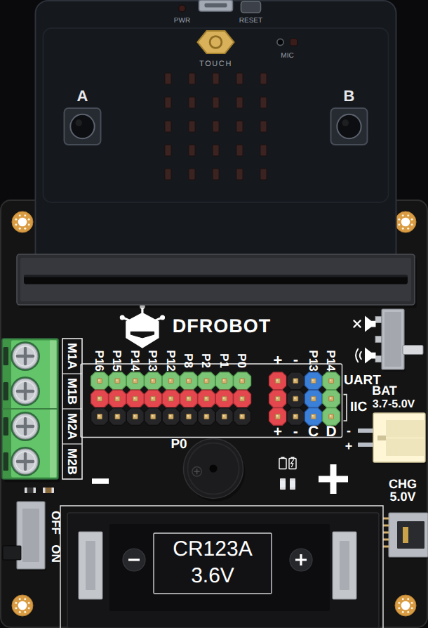

<!-- Generated by scripts/gen-boards.mjs — do not edit by hand. -->

The board as it appears on the Velxio canvas, with its full pin map
read live from the simulator (regenerated by `scripts/gen-boards.mjs`,
so it always matches what you can wire).

**Family:** [BBC micro:bit and DFRobot boards](/docs/boards/microbit/) ·
**Languages:** MicroPython

## About this board

DFRobot's compact robot controller for the micro:bit (MBT0005), with the
[BBC micro:bit V2](/docs/boards/reference/microbit-v2/) in its socket: a **two-way motor driver** on I2C, nine IO headers, two
I2C ports, a UART port and a buzzer on P0, on a board that carries its own
rechargeable cell.

Wire a DC motor across `M1A` and `M1B` (or `M2A` and `M2B`) and it turns
with the speed the program sends to the driver; in a 3D World the robot it
drives moves. The cell and its charger are drawn and do nothing.

**MicroPython only** for now: no Arduino/C++ and no MakeCode blocks. Radio
between boards on the canvas and Bluetooth are not modelled.

## Start here

- [Two motors forward and back](https://velxio.dev/example/microbit-v2-io-box-motors):
  DFRobot's own motor sample, with both motors already wired.

## Get the board

The micro:IO-BOX is sold on the [DFRobot store](https://www.dfrobot.com/product-1847.html?tracking=rzqVux&utm_source=velxio&utm_medium=docs&utm_content=microbit-v2-io-box).
The example runs in the browser without it.

_Affiliate link: if you buy through it, Velxio earns a small commission at no extra cost to you._

## Pins (45)

<ul class="pin-grid">
<li>M1A</li>
<li>M1B</li>
<li>M2A</li>
<li>M2B</li>
<li>P16</li>
<li>3V3.1</li>
<li>GND.1</li>
<li>P15</li>
<li>3V3.2</li>
<li>GND.2</li>
<li>P14</li>
<li>3V3.3</li>
<li>GND.3</li>
<li>P13</li>
<li>3V3.4</li>
<li>GND.4</li>
<li>P12</li>
<li>3V3.5</li>
<li>GND.5</li>
<li>P8</li>
<li>3V3.6</li>
<li>GND.6</li>
<li>P2</li>
<li>3V3.7</li>
<li>GND.7</li>
<li>P1</li>
<li>3V3.8</li>
<li>GND.8</li>
<li>P0</li>
<li>3V3.9</li>
<li>GND.9</li>
<li>3V3.10</li>
<li>GND.10</li>
<li>P13.2</li>
<li>P14.2</li>
<li>3V3.11</li>
<li>GND.11</li>
<li>P19</li>
<li>SCL</li>
<li>P20</li>
<li>SDA</li>
<li>3V3.12</li>
<li>GND.12</li>
<li>SCL.2</li>
<li>SDA.2</li>
</ul>

Every pin above is clickable on the canvas — click one to start a
[wire](/docs/circuit-editor/wiring/). Board-level behavior, quirks and
example links live on the [family page](/docs/boards/microbit/).
