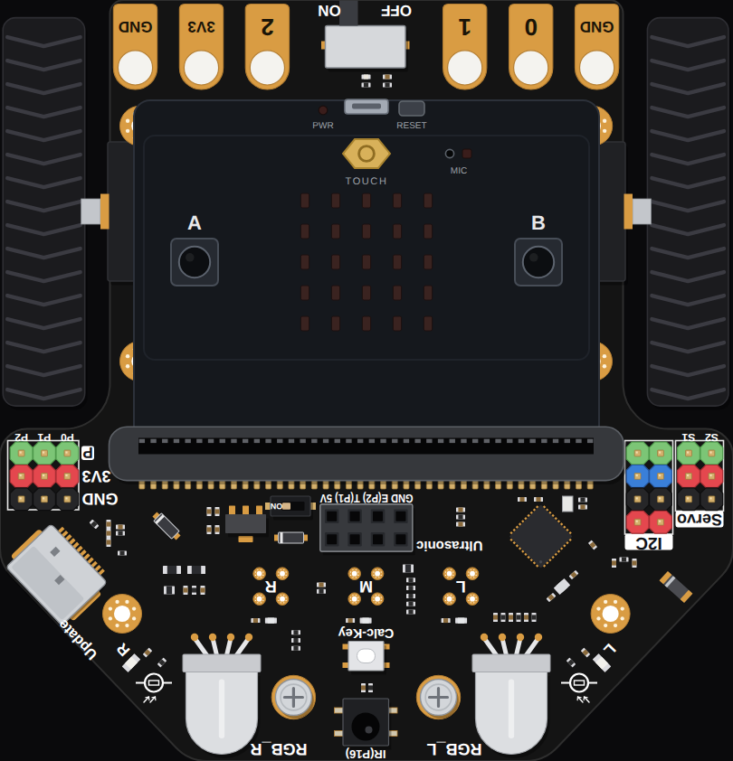

<!-- Generated by scripts/gen-boards.mjs — do not edit by hand. -->

The board as it appears on the Velxio canvas, with its full pin map
read live from the simulator (regenerated by `scripts/gen-boards.mjs`,
so it always matches what you can wire).

**Family:** [BBC micro:bit and DFRobot boards](/docs/boards/microbit/) ·
**Languages:** MicroPython

## About this board

The current Maqueen Lite (MBT0046), with the [BBC micro:bit V2](/docs/boards/reference/microbit-v2/) standing in its edge
socket. Next to the [classic Lite](/docs/boards/reference/microbit-v2-maqueen-lite/)
it moves most of the robot onto its own controller on I2C: **RGB
headlights**, three line sensors, two light sensors and a battery level,
beside the two motors and the two servo ports. The four RGB LEDs, the IR
receiver, the buzzer and the ultrasonic socket stay on micro:bit pins.

On the canvas the robot is one board: place it and the micro:bit comes
seated. The light sensors and the battery level are sliders in the
micro:bit's panel; click a line sensor on the drawing to put it over black.

**MicroPython only** for now: no Arduino/C++ and no MakeCode blocks. Radio
between boards on the canvas and Bluetooth are not modelled.

## Start here

- [Colour headlights and light sensors](https://velxio.dev/example/microbit-v2-maqueen-lite-v5-lights):
  cycles the headlights through their colours and prints both light
  readings while you move the sliders.

## Get the board

The Maqueen Lite V5 is sold on the [DFRobot store](https://www.dfrobot.com/product-2937.html?tracking=rzqVux&utm_source=velxio&utm_medium=docs&utm_content=microbit-v2-maqueen-lite-v5).
The example runs in the browser without it.

_Affiliate link: if you buy through it, Velxio earns a small commission at no extra cost to you._

## Pins (35)

<ul class="pin-grid">
<li>P0</li>
<li>3V3.1</li>
<li>GND.1</li>
<li>P1</li>
<li>3V3.2</li>
<li>GND.2</li>
<li>P2</li>
<li>3V3.3</li>
<li>GND.3</li>
<li>S1</li>
<li>VBAT.4</li>
<li>GND.4</li>
<li>S2</li>
<li>VBAT.5</li>
<li>GND.5</li>
<li>GND.6</li>
<li>E</li>
<li>T</li>
<li>5V.6</li>
<li>P20</li>
<li>SDA</li>
<li>P19</li>
<li>SCL</li>
<li>GND.7</li>
<li>5V.7</li>
<li>SDA.2</li>
<li>SCL.2</li>
<li>GND.8</li>
<li>5V.8</li>
<li>GND.9</li>
<li>0</li>
<li>1</li>
<li>2</li>
<li>3V3.10</li>
<li>GND.10</li>
</ul>

Every pin above is clickable on the canvas — click one to start a
[wire](/docs/circuit-editor/wiring/). Board-level behavior, quirks and
example links live on the [family page](/docs/boards/microbit/).
