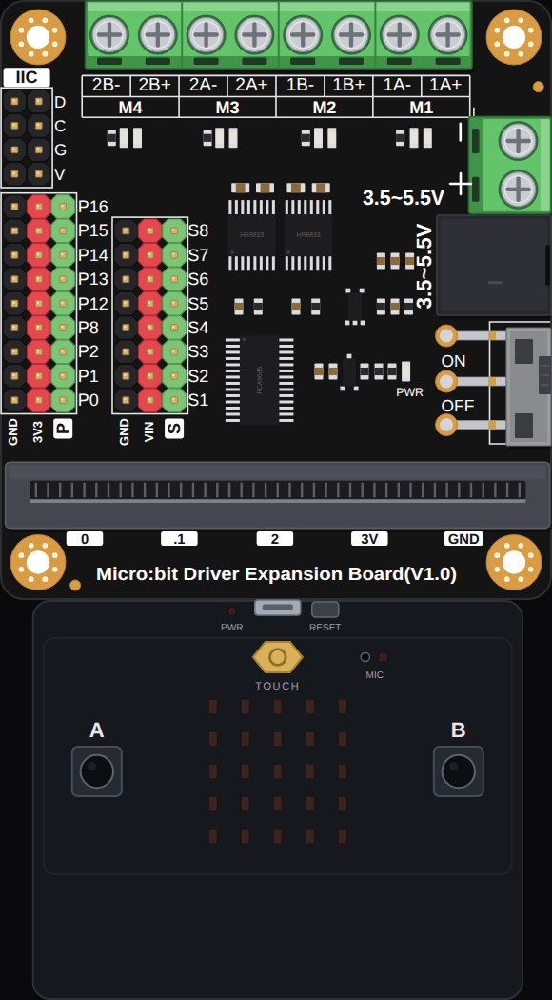

<!-- Generated by scripts/gen-boards.mjs — do not edit by hand. -->

The board as it appears on the Velxio canvas, with its full pin map
read live from the simulator (regenerated by `scripts/gen-boards.mjs`,
so it always matches what you can wire).

**Family:** [BBC micro:bit and DFRobot boards](/docs/boards/microbit/) ·
**Languages:** MicroPython

## About this board

DFRobot's motor and servo driver board for the micro:bit (DFR0548), with the
[BBC micro:bit V2](/docs/boards/reference/microbit-v2/) in its edge socket. One PCA9685 on I2C drives **four DC motor outputs**
and **eight servo headers**; nine micro:bit pins come out on 3-pin headers
and there are two I2C ports.

Wire a DC motor across a pair of motor terminals, or a servo to a servo
header, and it follows what the program writes to the chip. The green and
red LEDs under each motor output show which way that motor is driven.

**MicroPython only** for now: no Arduino/C++ and no MakeCode blocks. Radio
between boards on the canvas and Bluetooth are not modelled.

## Start here

- [Two servos and a DC motor](https://velxio.dev/example/microbit-v2-micro-driver-servos):
  sweeps S1 and S2 in opposite directions and runs M1 forward and back.

## Get the board

The micro:Driver is sold on the [DFRobot store](https://www.dfrobot.com/product-1738.html?tracking=rzqVux&utm_source=velxio&utm_medium=docs&utm_content=microbit-v2-micro-driver).
The example runs in the browser without it.

_Affiliate link: if you buy through it, Velxio earns a small commission at no extra cost to you._

## Pins (79)

<ul class="pin-grid">
<li>2B-</li>
<li>M4-</li>
<li>2B+</li>
<li>M4+</li>
<li>2A-</li>
<li>M3-</li>
<li>2A+</li>
<li>M3+</li>
<li>1B-</li>
<li>M2-</li>
<li>1B+</li>
<li>M2+</li>
<li>1A-</li>
<li>M1-</li>
<li>1A+</li>
<li>M1+</li>
<li>P20</li>
<li>SDA</li>
<li>P19</li>
<li>SCL</li>
<li>GND.21</li>
<li>3V3.21</li>
<li>SDA.2</li>
<li>SCL.2</li>
<li>GND.22</li>
<li>3V3.22</li>
<li>GND.9</li>
<li>3V3.9</li>
<li>P16</li>
<li>GND.8</li>
<li>3V3.8</li>
<li>P15</li>
<li>GND.7</li>
<li>3V3.7</li>
<li>P14</li>
<li>GND.6</li>
<li>3V3.6</li>
<li>P13</li>
<li>GND.5</li>
<li>3V3.5</li>
<li>P12</li>
<li>GND.4</li>
<li>3V3.4</li>
<li>P8</li>
<li>GND.3</li>
<li>3V3.3</li>
<li>P2</li>
<li>GND.2</li>
<li>3V3.2</li>
<li>P1</li>
<li>GND.1</li>
<li>3V3.1</li>
<li>P0</li>
<li>GND.18</li>
<li>VIN.18</li>
<li>S8</li>
<li>GND.17</li>
<li>VIN.17</li>
<li>S7</li>
<li>GND.16</li>
<li>VIN.16</li>
<li>S6</li>
<li>GND.15</li>
<li>VIN.15</li>
<li>S5</li>
<li>GND.14</li>
<li>VIN.14</li>
<li>S4</li>
<li>GND.13</li>
<li>VIN.13</li>
<li>S3</li>
<li>GND.12</li>
<li>VIN.12</li>
<li>S2</li>
<li>GND.11</li>
<li>VIN.11</li>
<li>S1</li>
<li>GND</li>
<li>VIN</li>
</ul>

Every pin above is clickable on the canvas — click one to start a
[wire](/docs/circuit-editor/wiring/). Board-level behavior, quirks and
example links live on the [family page](/docs/boards/microbit/).
