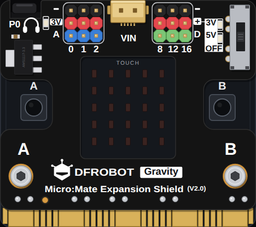

<!-- Generated by scripts/gen-boards.mjs — do not edit by hand. -->

The board as it appears on the Velxio canvas, with its full pin map
read live from the simulator (regenerated by `scripts/gen-boards.mjs`,
so it always matches what you can wire).

**Family:** [BBC micro:bit and DFRobot boards](/docs/boards/microbit/) ·
**Languages:** MicroPython

## About this board

A board the size of the micro:bit itself (DFR0518) that screws onto its
front: the display shows through a window and buttons A and B through two
cut-outs. It gives the [BBC micro:bit V2](/docs/boards/reference/microbit-v2/) **six 3-pin Gravity headers**: P0, P1 and P2 at
3.3 V, and P8, P12 and P16 on a supply meant for servos and other 5 V loads.

A Gravity module plugs in with its own cable; a loose part takes the signal
and the two supply pins of the same column. In the simulator the second
block's supply is held at 5 V. The touch logo sits under the board and
cannot be touched on the canvas.

**MicroPython only** for now: no Arduino/C++ and no MakeCode blocks. Radio
between boards on the canvas and Bluetooth are not modelled.

## Start here

- [A light sensor on P0](https://velxio.dev/example/microbit-v2-micro-mate-light):
  a Gravity ambient light sensor on the first header, shown as a bar on the
  matrix.

## Get the board

The micro:Mate is sold on the [DFRobot store](https://www.dfrobot.com/product-1699.html?tracking=rzqVux&utm_source=velxio&utm_medium=docs&utm_content=microbit-v2-micro-mate).
The example runs in the browser without it.

_Affiliate link: if you buy through it, Velxio earns a small commission at no extra cost to you._

## Pins (18)

<ul class="pin-grid">
<li>P0</li>
<li>3V3.1</li>
<li>GND.1</li>
<li>P1</li>
<li>3V3.2</li>
<li>GND.2</li>
<li>P2</li>
<li>3V3.3</li>
<li>GND.3</li>
<li>P8</li>
<li>5V.4</li>
<li>GND.4</li>
<li>P12</li>
<li>5V.5</li>
<li>GND.5</li>
<li>P16</li>
<li>5V.6</li>
<li>GND.6</li>
</ul>

Every pin above is clickable on the canvas — click one to start a
[wire](/docs/circuit-editor/wiring/). Board-level behavior, quirks and
example links live on the [family page](/docs/boards/microbit/).
