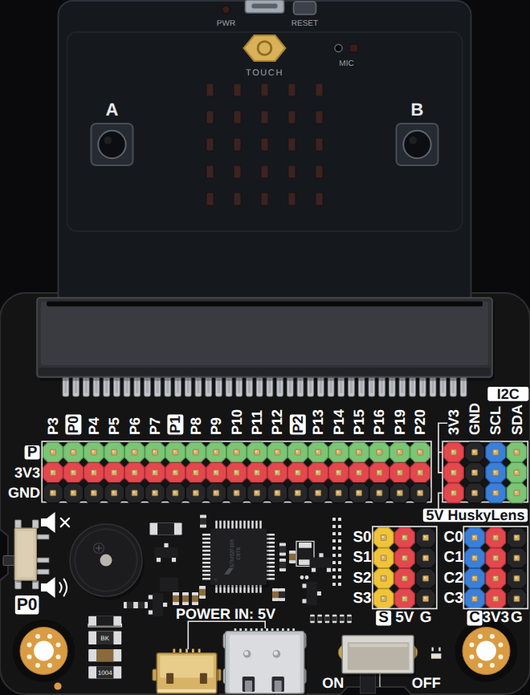

<!-- Generated by scripts/gen-boards.mjs — do not edit by hand. -->

The board as it appears on the Velxio canvas, with its full pin map
read live from the simulator (regenerated by `scripts/gen-boards.mjs`,
so it always matches what you can wire).

**Family:** [BBC micro:bit and DFRobot boards](/docs/boards/microbit/) ·
**Languages:** MicroPython

## About this board

DFRobot's expansion board for the micro:bit and the UNIHIKER K10 (DFR1231),
with the [BBC micro:bit V2](/docs/boards/reference/microbit-v2/) in its socket. For the micro:bit it is a full breakout: every
pin of the edge connector on a 3-pin header, two I2C ports at 3.3 V, one at
5 V, and a buzzer on P0 with a switch.

Its headers are those of the [IO Extender](/docs/boards/reference/microbit-v2-io-extender/),
in the same order, and Velxio gives the two the same pin names: a project
moves between them without renaming a wire. The servo ports S0 to S3 and the
ports C0 to C3 belong to the UNIHIKER K10; they are drawn and nothing wires
to them.

**MicroPython only** for now: no Arduino/C++ and no MakeCode blocks. Radio
between boards on the canvas and Bluetooth are not modelled.

## Start here

- [A light sensor on P1](https://velxio.dev/example/microbit-v2-robotics-io-extender-light):
  a Gravity ambient light sensor on one header, shown as a bar on the
  matrix.

## Get the board

The Robotics & Power IO Extender is sold on the [DFRobot store](https://www.dfrobot.com/product-2963.html?tracking=rzqVux&utm_source=velxio&utm_medium=docs&utm_content=microbit-v2-robotics-io-extender).
The example runs in the browser without it.

_Affiliate link: if you buy through it, Velxio earns a small commission at no extra cost to you._

## Pins (69)

<ul class="pin-grid">
<li>P3</li>
<li>3V3.1</li>
<li>GND.1</li>
<li>P0</li>
<li>3V3.2</li>
<li>GND.2</li>
<li>P4</li>
<li>3V3.3</li>
<li>GND.3</li>
<li>P5</li>
<li>3V3.4</li>
<li>GND.4</li>
<li>P6</li>
<li>3V3.5</li>
<li>GND.5</li>
<li>P7</li>
<li>3V3.6</li>
<li>GND.6</li>
<li>P1</li>
<li>3V3.7</li>
<li>GND.7</li>
<li>P8</li>
<li>3V3.8</li>
<li>GND.8</li>
<li>P9</li>
<li>3V3.9</li>
<li>GND.9</li>
<li>P10</li>
<li>3V3.10</li>
<li>GND.10</li>
<li>P11</li>
<li>3V3.11</li>
<li>GND.11</li>
<li>P12</li>
<li>3V3.12</li>
<li>GND.12</li>
<li>P2</li>
<li>3V3.13</li>
<li>GND.13</li>
<li>P13</li>
<li>3V3.14</li>
<li>GND.14</li>
<li>P14</li>
<li>3V3.15</li>
<li>GND.15</li>
<li>P15</li>
<li>3V3.16</li>
<li>GND.16</li>
<li>P16</li>
<li>3V3.17</li>
<li>GND.17</li>
<li>P19</li>
<li>3V3.18</li>
<li>GND.18</li>
<li>P20</li>
<li>3V3.19</li>
<li>GND.19</li>
<li>3V3.20</li>
<li>GND.20</li>
<li>SCL</li>
<li>SDA</li>
<li>3V3.21</li>
<li>GND.21</li>
<li>SCL.2</li>
<li>SDA.2</li>
<li>5V.22</li>
<li>GND.22</li>
<li>SCL.3</li>
<li>SDA.3</li>
</ul>

Every pin above is clickable on the canvas — click one to start a
[wire](/docs/circuit-editor/wiring/). Board-level behavior, quirks and
example links live on the [family page](/docs/boards/microbit/).
