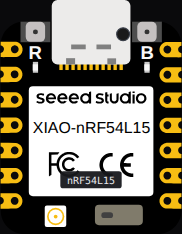

Pro-Boards sind die Premium-Kategorie des Katalogs: Markenhardware mit
umfangreichen integrierten Peripheriegeräten, tief genug emuliert, um ihre
**Werksfirmware** zu booten. Sie sind Teil des gehosteten Katalogs auf velxio.dev.

:::note[Welchen Plan benötigen sie?]
**Nur der UNIHIKER M10 erfordert einen kostenpflichtigen Plan.** Jedes andere Board auf
dieser Seite — M5Stack, Pimoroni, XIAO und das ESP32-C6 DevKit — **läuft im
kostenlosen Plan**. Die rein kostenpflichtigen Boards sind genau die STM32-Familie und die
Raspberry-Pi-Linux-Familie (zu der auch der UNIHIKER gehört). Siehe
[Pläne](/docs/de/getting-started/plans/).
:::

## M5Stack

_Kostenloser Plan._

### M5 Cardputer ADV

Der ESP32-S3-Taschencomputer mit Tastatur und TFT. Bootet die echte M5-
Launcher-Firmware; tippe auf der Bildschirmtastatur, starte Apps, nutze den
Lautsprecher.

Hole das echte Board im [M5Stack-Shop](https://shop.m5stack.com/products/m5stack-cardputer-adv-version-esp32-s3?ref=ehphcrsn&utm_source=velxio&utm_medium=docs-family&utm_content=cardputer-adv).

### M5Stack Core

Der klassische stapelbare ESP32 mit 320x240-TFT und drei Tasten.

Hole das echte Board im [M5Stack-Shop](https://shop.m5stack.com/products/esp32-basic-core-lot-development-kit-v2-7?ref=ehphcrsn&utm_source=velxio&utm_medium=docs-family&utm_content=m5stack-core).

*Die Shop-Links auf dieser Seite sind Affiliate-Links: Velxio erhält eine kleine Provision, ohne dass dir zusätzliche Kosten entstehen.*

## Pimoroni

_Kostenloser Plan._

### Badger 2350

Das RP2350-E-Paper-Badge. Es bootet die vollständige **BadgeOS-Werksfirmware**:
Navigiere mit den A/B/C/UP/DOWN-Tasten durch den Launcher, öffne
die Uhr-, Badge- und Galerie-Apps und beobachte, wie das E-Paper aktualisiert wird, so wie
E-Paper es wirklich tut.

### Galactic Unicorn

Die 53x11-RGB-LED-Matrix (583 Pixel), angetrieben von einem integrierten Pico 2 W
(RP2350), mit den A/B/C/D- und Lautstärke-/Helligkeitstasten.

### Pico Plus 2 W

Pimoronis RP2350B-Board im Standard-Pico-Format (GP0..GP28 plus
Stromversorgung), sodass jede Pico-Verkabelung direkt darauf passt. GPIO, UART, USB-Serial,
I2C und SPI laufen; der CYW43-WiFi-Coprozessor und PSRAM werden nicht emuliert.

## Seeed Studio XIAO

_Kostenloser Plan._

### XIAO ESP32S3 Sense

Der S3 mit Kameramodul, PDM-Mikrofon und microSD.

### XIAO ESP32C6

WiFi-6-fähiger RISC-V-C6 im XIAO-Format.

### XIAO RP2040

Der RP2040-XIAO mit seinem NeoPixel.

### XIAO RP2350

Der RP2350-XIAO — Dual-Core mit 150 MHz, Arduino C++ oder MicroPython.

### XIAO nRF52840 Sense

Nordics nRF52840 mit 6-Achsen-IMU: Neige ihn über die **Sensors**-Taste in
der Arbeitsflächen-Symbolleiste. Bluetooth wird nicht emuliert.

### Seeeduino XIAO (SAMD21)

Der ursprüngliche XIAO, mit einem echten DAC auf A0.

### XIAO RA4M1

Der MCU des UNO R4 Minima im XIAO-Format, inklusive 12-Bit-DAC.

### XIAO MG24 Sense

Silicon Labs' EFR32MG24 mit 6-Achsen-IMU. Das Funkmodul wird nicht emuliert.

### XIAO nRF54L15 Sense

Nordics nRF54L15 mit 6-Achsen-IMU. Das Funkmodul wird nicht emuliert.

### XIAO IPS Display Boards

Drei Trägerplatinen mit vorverlötetem XIAO nRF52840 Plus, von vorn und
hinten dargestellt: das [0,96"](/docs/de/boards/reference/xiao-096-display/) (80 x 160, zwei
Tasten), das [1,14"](/docs/de/boards/reference/xiao-114-display/) (135 x 240,
drei Tasten, Grove I2C) und das
[1,47" Touch](/docs/de/boards/reference/xiao-147-touch-display/) (172 x 320,
kapazitiver Touch, microSD). Das Glas ist der Speicher des emulierten
Panel-Controllers; die Tasten, die IMU, die Touch-Ebene und die Karte funktionieren alle, und
Seeeds eigene Demo-Sketches laufen unverändert.

## Espressif ESP32-C6

_Kostenloser Plan._

Das **ESP32-C6 DevKit** — der RISC-V-WiFi-6-Chip, mit demselben Sprach-
Trio (Arduino / MicroPython / ESP-IDF) wie der Rest der ESP32-Familie.

## DFRobot UNIHIKER M10

_Kostenpflichtiger Plan erforderlich._

Ein Linux-Einplatinencomputer mit integriertem Touchscreen — dokumentiert mit
der [Raspberry-Pi-Familie](/docs/de/boards/raspberry-pi/), da er den
Full-Linux-Workflow teilt. Wie der Rest dieser Familie ist er das einzige Board auf
dieser Seite, das **einen kostenpflichtigen Plan** zum Laufen benötigt.

Hole das echte Board im [DFRobot-Shop](https://www.dfrobot.com/product-2691.html?tracking=rzqVux&utm_source=velxio&utm_medium=docs-family&utm_content=unihiker-m10).

*Dieser Shop-Link ist ein Affiliate-Link: Velxio erhält eine kleine Provision, ohne dass dir zusätzliche Kosten entstehen.*

DFRobots Boards für den BBC micro:bit, vom Maqueen Lite Roboter bis zum
micro:Driver, laufen im kostenlosen Plan und haben eine eigene Seite:
[BBC micro:bit](/docs/de/boards/microbit/).

---

Pro-Boards erscheinen im [Komponenten-Auswahldialog](/docs/de/circuit-editor/placing-components/)
mit einem **PRO-Badge**; die [Starter-Vorlagen](/docs/de/getting-started/projects/)
enthalten sofort einsatzbereite Projekte für jedes.

## Board-Grafiken und Pinbelegungen

Die Arbeitsflächen-Grafik und die vollständige Pinbelegung jedes Boards, generiert aus dem Simulator:

[Badger 2350](/docs/de/boards/reference/badger-2350/) ·
[Galactic Unicorn](/docs/de/boards/reference/galactic-unicorn/) ·
[Pico Plus 2 W](/docs/de/boards/reference/pimoroni-pico-plus-2w/) ·
[M5 Cardputer ADV](/docs/de/boards/reference/cardputer-adv/) ·
[M5Stack Core](/docs/de/boards/reference/m5stack-core/) ·
[ESP32-C6 DevKit](/docs/de/boards/reference/esp32-c6/) ·
[XIAO ESP32S3 Sense](/docs/de/boards/reference/xiao-esp32s3-sense/) ·
[XIAO ESP32C6](/docs/de/boards/reference/xiao-esp32c6/) ·
[XIAO RP2040](/docs/de/boards/reference/xiao-rp2040/) ·
[XIAO RP2350](/docs/de/boards/reference/xiao-rp2350/) ·
[XIAO nRF52840 Sense](/docs/de/boards/reference/xiao-nrf52840-sense/) ·
[Seeeduino XIAO (SAMD21)](/docs/de/boards/reference/xiao-samd21/) ·
[XIAO RA4M1](/docs/de/boards/reference/xiao-ra4m1/) ·
[XIAO MG24 Sense](/docs/de/boards/reference/xiao-mg24-sense/) ·
[XIAO nRF54L15 Sense](/docs/de/boards/reference/xiao-nrf54l15-sense/) ·
[XIAO 0,96" IPS Display](/docs/de/boards/reference/xiao-096-display/) ·
[XIAO 1,14" IPS Display](/docs/de/boards/reference/xiao-114-display/) ·
[XIAO 1,47" IPS Touch Display](/docs/de/boards/reference/xiao-147-touch-display/) ·
[UNIHIKER M10](/docs/de/boards/reference/unihiker-m10/)
