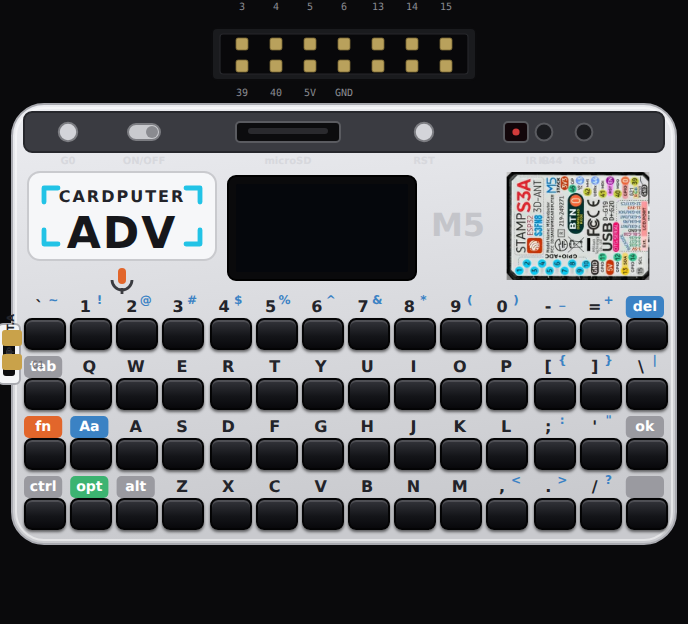
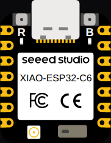
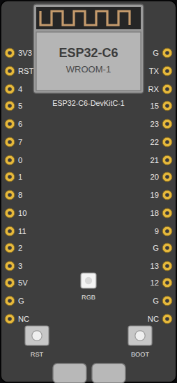

Las placas Pro son el nivel premium del catálogo: hardware de marca con
periféricos integrados completos, emulados con la profundidad suficiente
para arrancar su **firmware de fábrica**. Forman parte del catálogo alojado
en velxio.dev.

:::note[¿Qué plan necesitan?]
**Solo la UNIHIKER M10 requiere un plan de pago.** Todas las demás placas de
esta página (M5Stack, Pimoroni, XIAO y la ESP32-C6 DevKit) **funcionan con el
plan gratuito**. Las placas exclusivas de pago son exactamente la familia
STM32 y la familia Linux de Raspberry Pi (a la que pertenece la UNIHIKER).
Consulta [planes](/docs/es/getting-started/plans/).
:::

## M5Stack

_Plan gratuito._

### M5 Cardputer ADV

El ordenador de bolsillo ESP32-S3 con teclado y TFT. Arranca el firmware
real del lanzador de M5; escribe en el teclado en pantalla, ejecuta
aplicaciones, usa el altavoz.

Consigue la placa real en la [tienda de M5Stack](https://shop.m5stack.com/products/m5stack-cardputer-adv-version-esp32-s3?ref=ehphcrsn&utm_source=velxio&utm_medium=docs-family&utm_content=cardputer-adv).

### M5Stack Core

El clásico ESP32 apilable con TFT de 320x240 y tres botones.

Consigue la placa real en la [tienda de M5Stack](https://shop.m5stack.com/products/esp32-basic-core-lot-development-kit-v2-7?ref=ehphcrsn&utm_source=velxio&utm_medium=docs-family&utm_content=m5stack-core).

*Los enlaces de tienda de esta página son enlaces de afiliado: Velxio gana una pequeña comisión sin coste adicional para ti.*

## Pimoroni

_Plan gratuito._

### Badger 2350

La insignia de tinta electrónica RP2350. Arranca el **firmware de fábrica
BadgeOS** completo: navega por el lanzador con los botones A/B/C/UP/DOWN,
abre las aplicaciones de reloj, insignia y galería, y observa cómo la tinta
electrónica se refresca tal como lo hace en la realidad.

### Galactic Unicorn

La matriz de LED RGB de 53x11 (583 píxeles) controlada por un Pico 2 W
(RP2350) integrado, con los botones A/B/C/D y de volumen / brillo.

### Pico Plus 2 W

La placa RP2350B de Pimoroni con el factor de forma estándar de Pico
(GP0..GP28 más alimentación), así que cualquier cableado de Pico encaja
directamente. Funcionan GPIO, UART, USB serial, I2C y SPI; el coprocesador
WiFi CYW43 y la PSRAM no están emulados.

## Seeed Studio XIAO

_Plan gratuito._

### XIAO ESP32S3 Sense

La S3 con el módulo de cámara, micrófono PDM y microSD.

### XIAO ESP32C6

La C6 RISC-V con capacidad WiFi 6 en el factor de forma XIAO.

### XIAO RP2040

La XIAO RP2040 con su NeoPixel.

### XIAO RP2350

La XIAO RP2350: doble núcleo a 150 MHz, Arduino C++ o MicroPython.

### XIAO nRF52840 Sense

La nRF52840 de Nordic con una IMU de 6 ejes: inclínala desde el botón
**Sensors** (Sensores) de la barra de herramientas del lienzo. El Bluetooth
no está emulado.

### Seeeduino XIAO (SAMD21)

La XIAO original, con un DAC real en A0.

### XIAO RA4M1

El MCU de la UNO R4 Minima en el factor de forma XIAO, con DAC de 12 bits
incluido.

### XIAO MG24 Sense

La EFR32MG24 de Silicon Labs con una IMU de 6 ejes. La radio no está
emulada.

### XIAO nRF54L15 Sense

La nRF54L15 de Nordic con una IMU de 6 ejes. La radio no está emulada.

### Placas XIAO con pantalla IPS

Tres placas portadoras con una XIAO nRF52840 Plus prensoldada, dibujadas por
delante y por detrás: la [0.96"](/docs/es/boards/reference/xiao-096-display/) (80 x 160, dos
botones), la [1.14"](/docs/es/boards/reference/xiao-114-display/) (135 x 240,
tres botones, Grove I2C) y la
[1.47" Touch](/docs/es/boards/reference/xiao-147-touch-display/) (172 x 320,
táctil capacitiva, microSD). El cristal es la memoria del controlador de
panel emulado; los botones, la IMU, la capa táctil y la tarjeta funcionan, y
los sketches de demostración de Seeed se ejecutan sin cambios.

## Espressif ESP32-C6

_Plan gratuito._

La **ESP32-C6 DevKit**: el chip RISC-V con WiFi 6, con el mismo trío de
lenguajes (Arduino / MicroPython / ESP-IDF) que el resto de la familia
ESP32.

## DFRobot UNIHIKER M10

_Requiere plan de pago._

Un ordenador de placa única Linux con pantalla táctil integrada, documentado
con la [familia Raspberry Pi](/docs/es/boards/raspberry-pi/), ya que comparte el
flujo de trabajo de Linux completo. Como el resto de esa familia, es la única
placa de esta página que **necesita un plan de pago** para funcionar.

Consigue la placa real en la [tienda de DFRobot](https://www.dfrobot.com/product-2691.html?tracking=rzqVux&utm_source=velxio&utm_medium=docs-family&utm_content=unihiker-m10).

*Este enlace de tienda es un enlace de afiliado: Velxio gana una pequeña comisión sin coste adicional para ti.*

Las placas de DFRobot para el BBC micro:bit, desde el robot Maqueen Lite
hasta el micro:Driver, funcionan con el plan gratuito y tienen su propia
página: [BBC micro:bit](/docs/es/boards/microbit/).

---

Las placas Pro aparecen en el [selector de componentes](/docs/es/circuit-editor/placing-components/)
con una **insignia PRO**; las [plantillas de inicio](/docs/es/getting-started/projects/)
incluyen proyectos listos para ejecutar para cada una.

## Arte de las placas y pinouts

El arte del lienzo y el mapa de pines completo de cada placa, generados desde
el simulador:

[Badger 2350](/docs/es/boards/reference/badger-2350/) ·
[Galactic Unicorn](/docs/es/boards/reference/galactic-unicorn/) ·
[Pico Plus 2 W](/docs/es/boards/reference/pimoroni-pico-plus-2w/) ·
[M5 Cardputer ADV](/docs/es/boards/reference/cardputer-adv/) ·
[M5Stack Core](/docs/es/boards/reference/m5stack-core/) ·
[ESP32-C6 DevKit](/docs/es/boards/reference/esp32-c6/) ·
[XIAO ESP32S3 Sense](/docs/es/boards/reference/xiao-esp32s3-sense/) ·
[XIAO ESP32C6](/docs/es/boards/reference/xiao-esp32c6/) ·
[XIAO RP2040](/docs/es/boards/reference/xiao-rp2040/) ·
[XIAO RP2350](/docs/es/boards/reference/xiao-rp2350/) ·
[XIAO nRF52840 Sense](/docs/es/boards/reference/xiao-nrf52840-sense/) ·
[Seeeduino XIAO (SAMD21)](/docs/es/boards/reference/xiao-samd21/) ·
[XIAO RA4M1](/docs/es/boards/reference/xiao-ra4m1/) ·
[XIAO MG24 Sense](/docs/es/boards/reference/xiao-mg24-sense/) ·
[XIAO nRF54L15 Sense](/docs/es/boards/reference/xiao-nrf54l15-sense/) ·
[XIAO 0.96" IPS Display](/docs/es/boards/reference/xiao-096-display/) ·
[XIAO 1.14" IPS Display](/docs/es/boards/reference/xiao-114-display/) ·
[XIAO 1.47" IPS Touch Display](/docs/es/boards/reference/xiao-147-touch-display/) ·
[UNIHIKER M10](/docs/es/boards/reference/unihiker-m10/)
