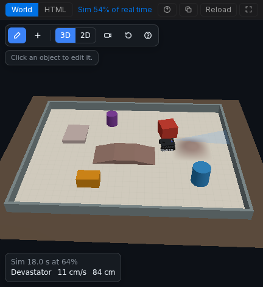

Un World creado con el kit de escenas de Velxio (todos los World que crea **Create a world for
this circuit**, y la [arena Devastator](/docs/es/worlds/example-devastator-tank/))
se puede editar con el ratón. Los cambios se guardan en `world.html`, así que van
allá donde vaya el proyecto.



## Modo de edición

Pulsa **Edit** (el lápiz) en la barra de herramientas del World.

- **Add** coloca un nuevo objeto sobre la alfombrilla:

  | Grupo     | Objetos                                                                       |
  | --------- | ----------------------------------------------------------------------------- |
  | Robots    | Robot 2WD, Robot 4WD, Robot tank (Devastator), Robot arm                      |
  | Tracks    | Loop, oval, figure 8, straight (cinta negra sobre la alfombrilla)             |
  | Obstacles | Box, wall, cylinder                                                           |
  | Terrain   | Ramp, bridge, hill                                                            |

- **Click** en un objeto para seleccionarlo y abrir sus propiedades.
- **Drag** para moverlo sobre la alfombrilla. **Q** y **E** lo rotan, **Shift** rota
  en pasos de 15 grados, **Delete** lo elimina.
- **Ctrl+Z** y **Ctrl+Y** deshacen y rehacen.
- **Mat settings** ajusta el tamaño, el color y la cuadrícula de la alfombrilla.

Funciona igual en la vista 3D y en la 2D. Pulsa Edit de nuevo para volver al
modo de juego.

## Conectar un robot al circuito

Un robot solo se mueve con los motores que le des, y solo alimenta los sensores que
le des. Selecciona el robot y elige, entre las piezas de tu lienzo:

| Campo                     | Qué elegir                                                                                                         |
| ------------------------- | ------------------------------------------------------------------------------------------------------------------ |
| **Motors: Left / Right**  | Uno o dos motores por lado. La velocidad de un lado sigue la media de accionamiento de sus motores.                |
| **Reverse left / right**  | Marca un lado cuyo "adelante" es un accionamiento negativo (su motor está cableado o montado al revés).           |
| **Line**                  | Seguidores de línea, de izquierda a derecha por el frontal (hasta cinco, a 18 mm de distancia).                    |
| **Sonar**                 | Un sensor de distancia en el parachoques delantero (URM09, URM37 o HC-SR04).                                      |
| **Sonar servo**           | Un servo que gira el sonar: 0 grados mira a la derecha, 90 al frente, 180 a la izquierda.                          |
| **IMU**                   | Un MPU6050 en el chasis.                                                                                           |

Un brazo robótico usa cuatro servos: base, hombro, codo y pinza.

## Robots

| Preset | Cuerpo         | Velocidad a pleno accionamiento | Trepa  | Similar a                              |
| ------ | -------------- | ------------------------------- | ------ | -------------------------------------- |
| 2WD    | 15 x 10.5 cm   | 0.55 m/s                        | 1 cm   | el clásico coche de kit de dos ruedas  |
| 4WD    | 20 x 11.5 cm   | 0.61 m/s                        | 1.5 cm | un coche de cuatro ruedas skid-steer   |
| Tank   | 22.5 x 22 cm   | 0.36 m/s                        | 3 cm   | el DFRobot Devastator, con orugas      |

Los robots se detienen contra cajas, paredes, cilindros y el borde de la alfombrilla, y
pasan por encima de cualquier cosa que no sea más alta que su altura de trepa. En una rampa suben
la pendiente y se inclinan con ella, un poco más despacio cuesta arriba.

## El formato de la escena

Detrás del editor, la escena es un bloque JSON en `world.html`:

```html
<!doctype html>
<html><body>
<script type="application/json" id="velxio-scene">
{ "version": 1, "view": "3d", "floor": { "w": 2.4, "h": 1.6, "grid": true },
  "objects": [
    { "id": "track1", "type": "track", "shape": "loop", "x": 0, "y": 0, "w": 2.1, "h": 0.9, "tape": 0.022 },
    { "id": "robot1", "type": "robot", "preset": "diff2", "x": -0.3, "y": -0.45, "rot": 0,
      "bind": { "left": ["motorL"], "right": ["motorR"], "line": ["lineL", "lineC", "lineR"] } },
    { "id": "box1", "type": "box", "x": 0.7, "y": 0.05, "w": 0.15, "d": 0.15, "h": 0.15, "color": "#c0392b" }
  ] }
</script>
<script>velxio.kit.start();</script>
</body></html>
```

- Las unidades son metros y grados. La alfombrilla (`floor`, `w` por `h`) está centrada en
  el origen: x hacia la derecha, y alejándose de ti, `rot` en sentido antihorario desde +x.
- Cada objeto tiene un `id` único, una posición `x`, `y`, y opcionalmente `rot`,
  `color` y `label`.
- `robot`: `preset` es `diff2`, `diff4` o `tank`. `bind` contiene `left`,
  `right` (listas de ids de motores), `invertLeft`, `invertRight`, `line` (ids de sensores,
  de izquierda a derecha), `sonar`, `sonarServo` e `imu`.
- `track`: `shape` es `loop`, `oval`, `figure8` o `line`, con `w`, `h` y
  `tape` (el ancho de la cinta, de 0.019 a 0.025 m). Para iniciar un seguidor de línea sobre la
  cinta de un loop centrado en el origen, colócalo en el tramo recto inferior con rumbo
  +x: `x: -0.3, y: -h/2, rot: 0`.
- `box` y `wall`: `w`, `d`, `h`. `cylinder`: `r`, `h`.
- `ramp`: `profile` es `wedge` (sube hacia +x, luego una cara vertical),
  `bridge` (subida, plano, bajada) o `hill` (un bulto suave, transitable desde cualquier lado),
  con `w`, `d`, `h`. El sonar ve caras verticales de 3 cm o más, nunca
  pendientes.
- `arm`: `bind` contiene los ids de los servos `base`, `shoulder`, `elbow` y `gripper`.

Los ids en `bind` que el circuito no tiene se ignoran, así que una escena nunca
rompe el proyecto. La [página de Devastator](/docs/es/worlds/example-devastator-tank/)
muestra una arena completa.
