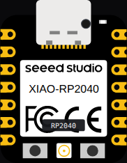
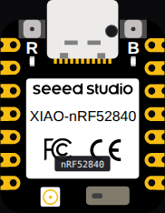

Les cartes Pro constituent le niveau haut de gamme du catalogue : du matériel de marque doté de riches
périphériques intégrés, émulé assez fidèlement pour démarrer leur **firmware
d'usine**. Elles font partie du catalogue hébergé sur velxio.dev.

:::note[Quel forfait faut-il ?]
**Seule l'UNIHIKER M10 nécessite un forfait payant.** Toutes les autres cartes de cette
page — M5Stack, Pimoroni, XIAO et l'ESP32-C6 DevKit — **fonctionnent avec le
forfait gratuit**. Les cartes réservées aux forfaits payants sont exactement la famille STM32 et la
famille Linux Raspberry Pi (à laquelle appartient l'UNIHIKER). Voir
[forfaits](/docs/fr/getting-started/plans/).
:::

## M5Stack

_Forfait gratuit._

### M5 Cardputer ADV

L'ordinateur de poche ESP32-S3 avec clavier et TFT. Démarre le véritable firmware
du lanceur M5 ; tapez sur le clavier à l'écran, lancez des applications, utilisez le
haut-parleur.

Procurez-vous la vraie carte sur la [boutique M5Stack](https://shop.m5stack.com/products/m5stack-cardputer-adv-version-esp32-s3?ref=ehphcrsn&utm_source=velxio&utm_medium=docs-family&utm_content=cardputer-adv).

### M5Stack Core

Le classique ESP32 empilable avec écran TFT 320x240 et trois boutons.

Procurez-vous la vraie carte sur la [boutique M5Stack](https://shop.m5stack.com/products/esp32-basic-core-lot-development-kit-v2-7?ref=ehphcrsn&utm_source=velxio&utm_medium=docs-family&utm_content=m5stack-core).

*Les liens de boutique sur cette page sont des liens d'affiliation : Velxio perçoit une petite commission sans coût supplémentaire pour vous.*

## Pimoroni

_Forfait gratuit._

### Badger 2350

Le badge à papier électronique RP2350. Il démarre le **firmware d'usine
BadgeOS** complet : naviguez dans le lanceur avec les boutons A/B/C/UP/DOWN, ouvrez
les applications horloge, badge et galerie, et observez le rafraîchissement du papier électronique comme
le papier électronique le fait réellement.

### Galactic Unicorn

La matrice de LED RVB 53x11 (583 pixels) pilotée par un Pico 2 W
(RP2350) embarqué, avec les boutons A/B/C/D et volume / luminosité.

### Pico Plus 2 W

La carte RP2350B de Pimoroni au format Pico standard (GP0..GP28 plus
alimentation), si bien que tout câblage Pico s'y adapte directement. GPIO, UART, série USB,
I2C et SPI fonctionnent ; le coprocesseur WiFi CYW43 et la PSRAM ne sont pas émulés.

## Seeed Studio XIAO

_Forfait gratuit._

### XIAO ESP32S3 Sense

Le S3 avec le module caméra, le microphone PDM et la microSD.

### XIAO ESP32C6

Le C6 RISC-V compatible WiFi 6 au format XIAO.

### XIAO RP2040

Le XIAO RP2040 avec son NeoPixel.

### XIAO RP2350

Le XIAO RP2350 — double cœur à 150 MHz, Arduino C++ ou MicroPython.

### XIAO nRF52840 Sense

Le nRF52840 de Nordic avec un IMU 6 axes : inclinez-le depuis le bouton **Sensors** (Capteurs) de
la barre d'outils du canevas. Le Bluetooth n'est pas émulé.

### Seeeduino XIAO (SAMD21)

Le XIAO d'origine, avec un véritable DAC sur A0.

### XIAO RA4M1

Le MCU de l'UNO R4 Minima au format XIAO, DAC 12 bits inclus.

### XIAO MG24 Sense

L'EFR32MG24 de Silicon Labs avec un IMU 6 axes. La radio n'est pas émulée.

### XIAO nRF54L15 Sense

Le nRF54L15 de Nordic avec un IMU 6 axes. La radio n'est pas émulée.

### Cartes XIAO IPS Display

Trois cartes porteuses avec un XIAO nRF52840 Plus pré-soudé, dessinées recto et
verso : la [0.96"](/docs/fr/boards/reference/xiao-096-display/) (80 x 160, deux
boutons), la [1.14"](/docs/fr/boards/reference/xiao-114-display/) (135 x 240,
trois boutons, Grove I2C) et la
[1.47" Touch](/docs/fr/boards/reference/xiao-147-touch-display/) (172 x 320,
tactile capacitif, microSD). La vitre correspond à la mémoire du contrôleur d'écran
émulé ; les boutons, l'IMU, la couche tactile et la carte fonctionnent tous, et
les sketches de démonstration de Seeed s'exécutent sans modification.

## Espressif ESP32-C6

_Forfait gratuit._

L'**ESP32-C6 DevKit** — la puce RISC-V WiFi-6, avec le même trio de
langages (Arduino / MicroPython / ESP-IDF) que le reste de la famille ESP32.

## DFRobot UNIHIKER M10

_Forfait payant requis._

Un ordinateur monocarte Linux avec écran tactile intégré — documenté avec
la [famille Raspberry Pi](/docs/fr/boards/raspberry-pi/), puisqu'il partage le
flux de travail Linux complet. Comme le reste de cette famille, c'est la seule carte de
cette page qui **nécessite un forfait payant** pour fonctionner.

Procurez-vous la vraie carte sur la [boutique DFRobot](https://www.dfrobot.com/product-2691.html?tracking=rzqVux&utm_source=velxio&utm_medium=docs-family&utm_content=unihiker-m10).

*Ce lien de boutique est un lien d'affiliation : Velxio perçoit une petite commission sans coût supplémentaire pour vous.*

Les cartes DFRobot pour le BBC micro:bit, du robot Maqueen Lite au
micro:Driver, fonctionnent avec le forfait gratuit et disposent de leur propre page :
[BBC micro:bit](/docs/fr/boards/microbit/).

---

Les cartes Pro apparaissent dans le [sélecteur de composants](/docs/fr/circuit-editor/placing-components/)
avec un **badge PRO** ; les [modèles de démarrage](/docs/fr/getting-started/projects/)
incluent des projets prêts à l'emploi pour chacune.

## Illustrations et brochages des cartes

L'illustration sur le canevas et le brochage complet de chaque carte, générés depuis le simulateur :

[Badger 2350](/docs/fr/boards/reference/badger-2350/) ·
[Galactic Unicorn](/docs/fr/boards/reference/galactic-unicorn/) ·
[Pico Plus 2 W](/docs/fr/boards/reference/pimoroni-pico-plus-2w/) ·
[M5 Cardputer ADV](/docs/fr/boards/reference/cardputer-adv/) ·
[M5Stack Core](/docs/fr/boards/reference/m5stack-core/) ·
[ESP32-C6 DevKit](/docs/fr/boards/reference/esp32-c6/) ·
[XIAO ESP32S3 Sense](/docs/fr/boards/reference/xiao-esp32s3-sense/) ·
[XIAO ESP32C6](/docs/fr/boards/reference/xiao-esp32c6/) ·
[XIAO RP2040](/docs/fr/boards/reference/xiao-rp2040/) ·
[XIAO RP2350](/docs/fr/boards/reference/xiao-rp2350/) ·
[XIAO nRF52840 Sense](/docs/fr/boards/reference/xiao-nrf52840-sense/) ·
[Seeeduino XIAO (SAMD21)](/docs/fr/boards/reference/xiao-samd21/) ·
[XIAO RA4M1](/docs/fr/boards/reference/xiao-ra4m1/) ·
[XIAO MG24 Sense](/docs/fr/boards/reference/xiao-mg24-sense/) ·
[XIAO nRF54L15 Sense](/docs/fr/boards/reference/xiao-nrf54l15-sense/) ·
[XIAO 0.96" IPS Display](/docs/fr/boards/reference/xiao-096-display/) ·
[XIAO 1.14" IPS Display](/docs/fr/boards/reference/xiao-114-display/) ·
[XIAO 1.47" IPS Touch Display](/docs/fr/boards/reference/xiao-147-touch-display/) ·
[UNIHIKER M10](/docs/fr/boards/reference/unihiker-m10/)
