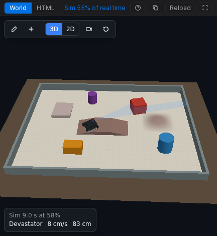

Le char DFRobot Devastator sur un Romeo BLE exécute l'exemple d'évitement
d'obstacles de DFRobot. Il avance jusqu'à ce que l'URM37 monté sur son servo
lise moins de 35 cm, regarde à droite et à gauche, recule, puis tourne vers le
côté offrant le plus d'espace. Le World est une arène avec des obstacles carrés
et ronds, un pont, une colline et une rampe, réalisée avec le kit de scène,
afin que vous puissiez la modifier à la souris.

**L'ouvrir :** [velxio.dev/example/dfrobot-devastator-tank-avoidance](https://velxio.dev/example/dfrobot-devastator-tank-avoidance)
puis appuyez sur **Run**.



## Pièces

| Id                   | Pièce                                                  |
| -------------------- | ------------------------------------------------------ |
| `dfrobot-romeo-ble`  | DFRobot Romeo BLE (deux canaux moteur intégrés)        |
| `motorL`, `motorR`   | Motoréducteur avec encodeur, 45:1                      |
| `servo1`             | Servo qui oriente le sonar                             |
| `urm37`              | DFRobot URM37 V5.0 à ultrasons, mode PWM               |

## Câblage

| De                        | Vers (Romeo BLE) |
| ------------------------- | ---------------- |
| `motorL` M1 / M2          | M1+ / M1-        |
| `motorR` M1 / M2          | M2+ / M2-        |
| `servo1` PWM / V+ / GND   | D10 / 5V / GND   |
| `urm37` ECHO              | D8               |
| `urm37` TRIG (COMP/TRIG)  | D9               |
| `urm37` VCC / GND         | 5V / GND         |

## Firmware

Le sketch est l'exemple de DFRobot pour le Devastator (`Avoidance_URM37.ino`, par
Gavin, 2015), avec les deux bibliothèques qu'il inclut, `DFMobile` et `URM37`,
sous forme de fichiers du projet. Seules deux choses ont changé dans la copie du
projet : les fins de ligne, et les includes qui utilisent des guillemets car les
bibliothèques sont livrées à côté du sketch. La liste ci-dessous raccourcit les
commentaires de DFRobot.

```cpp
#include "DFMobile.h"
DFMobile Robot (4,5,7,6);   // left dir D4 / PWM D5, right dir D7 / PWM D6

#include<Servo.h>
Servo myservo;

#include "URM37.h"
ultrasonic URM37;
double distance;
int i=0;
int distanceBuffer[3];

void setup(){
  myservo.attach(10);
  Robot.Direction(LOW,HIGH);   // (left direction, right direction)
  Serial.begin (115200);
  URM37.Init(8,9);             // ECHO on D8, COMP/TRIG on D9
}

void loop(){
  myservo.write(90);           // look ahead
  Robot.Speed(80,80);          // forward
  Measurement();

  if(distance < 35){
    Robot.Speed (0,0);         // stop
    myservo.write(0);          // look right
    Measurement();
    delay(200);
    double degree_0 = distance;
    delay(50);
    myservo.write(180);        // look left
    Measurement();
    delay(200);
    double degree_180 = distance;
    delay(50);

    if(degree_0 > degree_180){
      Robot.Speed(-200,-200);  // back off
      delay(50);
      Robot.Speed(200,-200);   // turn right
      delay(200);
    }
    else{
      Robot.Speed(-200,-200);  // back off
      delay(50);
      Robot.Speed(-200,200);   // turn left
      delay(200);
    }
  }
  else{
    myservo.write(90);
    Robot.Speed (100,100);     // forward
  }
}

void Measurement(){
  distanceBuffer[i] = URM37.Distance();
  i++;
  if(i>2){
    i=0;
  }
  // the largest of the last three readings
  distance = distanceBuffer[0]>distanceBuffer[1] && distanceBuffer[0]>distanceBuffer[2]?distanceBuffer[0]:(distanceBuffer[1]>distanceBuffer[2]?distanceBuffer[1]:distanceBuffer[2]);
  Serial.print(distance);
  Serial.println (" cm");
  delay (100);
}
```

`Robot.Direction(LOW, HIGH)` fait de « tout droit » un niveau de direction LOW
des deux côtés, car le châssis réel monte ses moteurs en miroir. Le World
l'indique avec **Reverse** des deux côtés du char (`invertLeft` et
`invertRight`), afin que le sketch reste exactement celui de DFRobot.

## Le World

La scène (dans `world.html`, modifiable avec **Edit**) :

```json
{ "version": 1, "view": "3d", "floor": { "w": 3.0, "h": 2.4, "color": "#d8d2c4", "grid": true },
  "objects": [
    { "id": "wallN", "type": "wall", "x": 0, "y": 1.18, "rot": 0, "w": 3.0, "d": 0.04, "h": 0.15, "color": "#7f8c8d" },
    { "id": "wallS", "type": "wall", "x": 0, "y": -1.18, "rot": 0, "w": 3.0, "d": 0.04, "h": 0.15, "color": "#7f8c8d" },
    { "id": "wallE", "type": "wall", "x": 1.48, "y": 0, "rot": 90, "w": 2.32, "d": 0.04, "h": 0.15, "color": "#7f8c8d" },
    { "id": "wallW", "type": "wall", "x": -1.48, "y": 0, "rot": 90, "w": 2.32, "d": 0.04, "h": 0.15, "color": "#7f8c8d" },
    { "id": "box1", "type": "box", "x": 0.55, "y": 0.5, "rot": 15, "w": 0.25, "d": 0.25, "h": 0.2, "color": "#c0392b" },
    { "id": "box2", "type": "box", "x": -0.55, "y": -0.65, "rot": 0, "w": 0.3, "d": 0.18, "h": 0.15, "color": "#d68910" },
    { "id": "cyl1", "type": "cylinder", "x": 0.95, "y": -0.55, "r": 0.12, "h": 0.25, "color": "#2e86c1" },
    { "id": "cyl2", "type": "cylinder", "x": -0.35, "y": 0.75, "r": 0.09, "h": 0.2, "color": "#7d3c98" },
    { "id": "bridge1", "type": "ramp", "profile": "bridge", "x": -0.1, "y": -0.05, "rot": 0, "w": 0.9, "d": 0.4, "h": 0.07, "color": "#8d6e63" },
    { "id": "hill1", "type": "ramp", "profile": "hill", "x": 0.9, "y": 0.15, "rot": 0, "w": 0.6, "d": 0.6, "h": 0.06, "color": "#a1887f" },
    { "id": "ramp1", "type": "ramp", "profile": "wedge", "x": -0.9, "y": 0.45, "rot": -90, "w": 0.5, "d": 0.35, "h": 0.06, "color": "#bcaaa4" },
    { "id": "tank1", "type": "robot", "preset": "tank", "label": "Devastator", "x": -1.05, "y": -0.3, "rot": 0, "color": "#1f2326",
      "bind": { "left": ["motorL"], "right": ["motorR"], "invertLeft": true, "invertRight": true,
                "sonar": "urm37", "sonarServo": "servo1" } }
  ] }
```

- L'URM37 regarde là où le servo le pointe : `sonarServo` oriente le sonar
  selon l'angle du servo (0 degré à droite, 90 devant, 180 à gauche).
- Le char grimpe jusqu'à 3 cm, il franchit donc le pont, la colline et la
  rampe, et s'arrête contre les boîtes, les cylindres et les murs.
- Chaque espace entre les obstacles est plus large que le char de 22 cm, il ne
  reste donc jamais coincé.


## À essayer ensuite

- Appuyez sur **Edit**, déplacez une boîte sur la trajectoire du char, et
  observez-le balayer et tourner.
- Remplacez `35` dans `loop()` par `20` et voyez à quel point il s'approche
  avant de regarder autour de lui.
- Ajoutez un MPU6050 au circuit, associez-le au char comme son **IMU** dans
  l'éditeur, et lisez la vitesse de rotation dans le sketch.
