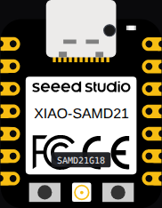

Le schede Pro sono il livello premium del catalogo: hardware di marca con
periferiche integrate ricche, emulato in modo abbastanza profondo da avviare
il loro **firmware di fabbrica**. Fanno parte del catalogo ospitato su velxio.dev.

:::note[Quale piano richiedono?]
**Solo la UNIHIKER M10 richiede un piano a pagamento.** Ogni altra scheda in
questa pagina — M5Stack, Pimoroni, XIAO e l'ESP32-C6 DevKit — **funziona con il
piano gratuito**. Le schede solo a pagamento sono esattamente la famiglia STM32
e la famiglia Linux Raspberry Pi (a cui appartiene la UNIHIKER). Vedi
[i piani](/docs/it/getting-started/plans/).
:::

## M5Stack

_Piano gratuito._

### M5 Cardputer ADV

Il computer tascabile ESP32-S3 con tastiera e TFT. Avvia il vero firmware del
launcher M5; digita sulla tastiera sullo schermo, esegui le app, usa lo
speaker.

Trova la scheda reale sullo [store M5Stack](https://shop.m5stack.com/products/m5stack-cardputer-adv-version-esp32-s3?ref=ehphcrsn&utm_source=velxio&utm_medium=docs-family&utm_content=cardputer-adv).

### M5Stack Core

Il classico ESP32 impilabile con TFT 320x240 e tre pulsanti.

Trova la scheda reale sullo [store M5Stack](https://shop.m5stack.com/products/esp32-basic-core-lot-development-kit-v2-7?ref=ehphcrsn&utm_source=velxio&utm_medium=docs-family&utm_content=m5stack-core).

*I link agli store in questa pagina sono link affiliati: Velxio guadagna una piccola commissione senza alcun costo aggiuntivo per te.*

## Pimoroni

_Piano gratuito._

### Badger 2350

Il badge e-paper RP2350. Avvia il completo **firmware di fabbrica BadgeOS**:
naviga nel launcher con i pulsanti A/B/C/UP/DOWN, apri le app orologio, badge
e galleria, e osserva l'e-paper aggiornarsi proprio come fa l'e-paper reale.

### Galactic Unicorn

La matrice di LED RGB 53x11 (583 pixel) pilotata da un Pico 2 W (RP2350)
integrato, con i pulsanti A/B/C/D e volume / luminosità.

### Pico Plus 2 W

La scheda RP2350B di Pimoroni nel formato Pico standard (GP0..GP28 più
alimentazione), così qualsiasi cablaggio Pico si adatta direttamente. GPIO, UART, seriale
USB, I2C e SPI funzionano; il coprocessore WiFi CYW43 e la PSRAM non sono emulati.

## Seeed Studio XIAO

_Piano gratuito._

### XIAO ESP32S3 Sense

L'S3 con modulo fotocamera, microfono PDM e microSD.

### XIAO ESP32C6

Il C6 RISC-V con capacità WiFi 6 nel formato XIAO.

### XIAO RP2040

La XIAO RP2040 con il suo NeoPixel.

### XIAO RP2350

La XIAO RP2350 — dual core a 150 MHz, Arduino C++ o MicroPython.

### XIAO nRF52840 Sense

L'nRF52840 di Nordic con IMU a 6 assi: inclinala dal pulsante **Sensors** sulla
barra degli strumenti della tela. Il Bluetooth non è emulato.

### Seeeduino XIAO (SAMD21)

La XIAO originale, con un vero DAC su A0.

### XIAO RA4M1

L'MCU della UNO R4 Minima nel formato XIAO, DAC a 12 bit incluso.

### XIAO MG24 Sense

L'EFR32MG24 di Silicon Labs con IMU a 6 assi. La radio non è emulata.

### XIAO nRF54L15 Sense

L'nRF54L15 di Nordic con IMU a 6 assi. La radio non è emulata.

### Schede XIAO con display IPS

Tre schede carrier con una XIAO nRF52840 Plus pre-saldata, disegnate fronte e
retro: la [0.96"](/docs/it/boards/reference/xiao-096-display/) (80 x 160, due
pulsanti), la [1.14"](/docs/it/boards/reference/xiao-114-display/) (135 x 240,
tre pulsanti, Grove I2C) e la
[1.47" Touch](/docs/it/boards/reference/xiao-147-touch-display/) (172 x 320,
touch capacitivo, microSD). Il vetro è la memoria del controller del pannello
emulato; i pulsanti, l'IMU, il livello touch e la scheda funzionano tutti, e
gli sketch demo di Seeed funzionano senza modifiche.

## Espressif ESP32-C6

_Piano gratuito._

L'**ESP32-C6 DevKit** — il chip RISC-V WiFi-6, con lo stesso trio di linguaggi
(Arduino / MicroPython / ESP-IDF) del resto della famiglia ESP32.

## DFRobot UNIHIKER M10

_Richiede un piano a pagamento._

Un computer single-board Linux con touchscreen integrato — documentato con
la [famiglia Raspberry Pi](/docs/it/boards/raspberry-pi/), poiché condivide il
flusso di lavoro Linux completo. Come il resto di quella famiglia, è l'unica scheda
in questa pagina che **richiede un piano a pagamento** per funzionare.

Trova la scheda reale sullo [store DFRobot](https://www.dfrobot.com/product-2691.html?tracking=rzqVux&utm_source=velxio&utm_medium=docs-family&utm_content=unihiker-m10).

*Questo link allo store è un link affiliato: Velxio guadagna una piccola commissione senza alcun costo aggiuntivo per te.*

Le schede DFRobot per il BBC micro:bit, dal robot Maqueen Lite al
micro:Driver, funzionano con il piano gratuito e hanno una pagina propria:
[BBC micro:bit](/docs/it/boards/microbit/).

---

Le schede Pro compaiono nel [selettore dei componenti](/docs/it/circuit-editor/placing-components/)
con un **badge PRO**; i [template iniziali](/docs/it/getting-started/projects/)
includono progetti pronti all'uso per ciascuna.

## Grafica delle schede e pinout

La grafica sulla tela e la mappa completa dei pin di ogni scheda, generate dal simulatore:

[Badger 2350](/docs/it/boards/reference/badger-2350/) ·
[Galactic Unicorn](/docs/it/boards/reference/galactic-unicorn/) ·
[Pico Plus 2 W](/docs/it/boards/reference/pimoroni-pico-plus-2w/) ·
[M5 Cardputer ADV](/docs/it/boards/reference/cardputer-adv/) ·
[M5Stack Core](/docs/it/boards/reference/m5stack-core/) ·
[ESP32-C6 DevKit](/docs/it/boards/reference/esp32-c6/) ·
[XIAO ESP32S3 Sense](/docs/it/boards/reference/xiao-esp32s3-sense/) ·
[XIAO ESP32C6](/docs/it/boards/reference/xiao-esp32c6/) ·
[XIAO RP2040](/docs/it/boards/reference/xiao-rp2040/) ·
[XIAO RP2350](/docs/it/boards/reference/xiao-rp2350/) ·
[XIAO nRF52840 Sense](/docs/it/boards/reference/xiao-nrf52840-sense/) ·
[Seeeduino XIAO (SAMD21)](/docs/it/boards/reference/xiao-samd21/) ·
[XIAO RA4M1](/docs/it/boards/reference/xiao-ra4m1/) ·
[XIAO MG24 Sense](/docs/it/boards/reference/xiao-mg24-sense/) ·
[XIAO nRF54L15 Sense](/docs/it/boards/reference/xiao-nrf54l15-sense/) ·
[XIAO 0.96" IPS Display](/docs/it/boards/reference/xiao-096-display/) ·
[XIAO 1.14" IPS Display](/docs/it/boards/reference/xiao-114-display/) ·
[XIAO 1.47" IPS Touch Display](/docs/it/boards/reference/xiao-147-touch-display/) ·
[UNIHIKER M10](/docs/it/boards/reference/unihiker-m10/)
