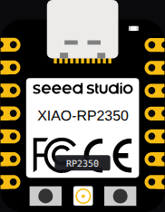
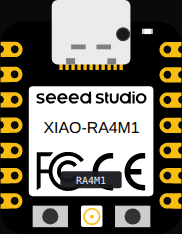

Proボードはカタログのプレミアム層です。豊富な内蔵ペリフェラルを備えたブランドハードウェアで、**工場出荷ファームウェア**を起動できるほど深くエミュレートされています。velxio.devのホスト型カタログの一部です。

:::note[必要なプランは？]
**有料プランが必要なのはUNIHIKER M10のみです。** このページの他のすべてのボード — M5Stack、Pimoroni、XIAO、ESP32-C6 DevKit — は**無料プランで動作します**。有料専用ボードはちょうどSTM32ファミリーとRaspberry Pi Linuxファミリーです（UNIHIKERはこちらに属します）。詳しくは[プラン](/docs/ja/getting-started/plans/)をご覧ください。
:::

## M5Stack

_無料プラン。_

### M5 Cardputer ADV

キーボードとTFTを備えたESP32-S3ポケットコンピュータ。実際のM5ランチャーファームウェアを起動します。画面上のキーボードで入力し、アプリを実行し、スピーカーを使用できます。

実機は[M5Stackストア](https://shop.m5stack.com/products/m5stack-cardputer-adv-version-esp32-s3?ref=ehphcrsn&utm_source=velxio&utm_medium=docs-family&utm_content=cardputer-adv)で入手できます。

### M5Stack Core

320x240 TFTと3つのボタンを備えた、定番のスタッキング可能なESP32。

実機は[M5Stackストア](https://shop.m5stack.com/products/esp32-basic-core-lot-development-kit-v2-7?ref=ehphcrsn&utm_source=velxio&utm_medium=docs-family&utm_content=m5stack-core)で入手できます。

*このページのストアリンクはアフィリエイトリンクです。Velxioは追加費用なしで少額の手数料を得ます。*

## Pimoroni

_無料プラン。_

### Badger 2350

RP2350電子ペーパーバッジ。完全な**BadgeOS工場出荷ファームウェア**を起動します。A/B/C/UP/DOWNボタンでランチャーを操作し、時計、バッジ、ギャラリーアプリを開き、電子ペーパーが実際と同じようにリフレッシュされる様子を確認できます。

### Galactic Unicorn

オンボードのPico 2 W（RP2350）で駆動する53x11 RGB LEDマトリクス（583ピクセル）。A/B/C/Dボタンと音量/明るさボタンを備えています。

### Pico Plus 2 W

標準Picoフットプリント（GP0..GP28と電源）のPimoroni RP2350Bボードなので、Pico用の配線をそのまま接続できます。GPIO、UART、USBシリアル、I2C、SPIが動作します。CYW43 WiFiコプロセッサとPSRAMはエミュレートされません。

## Seeed Studio XIAO

_無料プラン。_

### XIAO ESP32S3 Sense

カメラモジュール、PDMマイク、microSDを備えたS3。

### XIAO ESP32C6

XIAOフットプリントのWiFi 6対応RISC-V C6。

### XIAO RP2040

NeoPixelを備えたRP2040 XIAO。

### XIAO RP2350

RP2350 XIAO — 150 MHzデュアルコア、Arduino C++またはMicroPython。

### XIAO nRF52840 Sense

6軸IMUを備えたNordicのnRF52840。キャンバスツールバーの**Sensors**ボタンから傾けられます。Bluetoothはエミュレートされません。

### Seeeduino XIAO (SAMD21)

オリジナルのXIAO。A0に本物のDACを備えています。

### XIAO RA4M1

UNO R4 MinimaのMCUをXIAOフットプリントに搭載。12ビットDAC付き。

### XIAO MG24 Sense

6軸IMUを備えたSilicon LabsのEFR32MG24。無線はエミュレートされません。

### XIAO nRF54L15 Sense

6軸IMUを備えたNordicのnRF54L15。無線はエミュレートされません。

### XIAO IPS Displayボード

XIAO nRF52840 Plusが実装済みの3つのキャリアボードを、表裏両面で描画しています。[0.96"](/docs/ja/boards/reference/xiao-096-display/)（80 x 160、2ボタン）、[1.14"](/docs/ja/boards/reference/xiao-114-display/)（135 x 240、3ボタン、Grove I2C）、[1.47" Touch](/docs/ja/boards/reference/xiao-147-touch-display/)（172 x 320、静電容量式タッチ、microSD）。ガラス部分はエミュレートされたパネルコントローラのメモリです。ボタン、IMU、タッチレイヤー、カードはすべて動作し、Seeed自身のデモスケッチがそのまま実行できます。

## Espressif ESP32-C6

_無料プラン。_

**ESP32-C6 DevKit** — RISC-V WiFi-6チップ。ESP32ファミリーの他のボードと同じ3言語（Arduino / MicroPython / ESP-IDF）に対応しています。

## DFRobot UNIHIKER M10

_有料プランが必要です。_

タッチスクリーン内蔵のLinuxシングルボードコンピュータ。フルLinuxワークフローを共有するため、[Raspberry Piファミリー](/docs/ja/boards/raspberry-pi/)とともにドキュメント化されています。そのファミリーの他のボードと同様、このページで**実行に有料プランが必要**な唯一のボードです。

実機は[DFRobotストア](https://www.dfrobot.com/product-2691.html?tracking=rzqVux&utm_source=velxio&utm_medium=docs-family&utm_content=unihiker-m10)で入手できます。

*このストアリンクはアフィリエイトリンクです。Velxioは追加費用なしで少額の手数料を得ます。*

Maqueen Liteロボットからmicro:Driverまで、BBC micro:bit向けのDFRobotボードは無料プランで動作し、専用ページがあります：[BBC micro:bit](/docs/ja/boards/microbit/)。

---

Proボードは[コンポーネントピッカー](/docs/ja/circuit-editor/placing-components/)に**PROバッジ**付きで表示されます。[スターターテンプレート](/docs/ja/getting-started/projects/)には、それぞれすぐに実行できるプロジェクトが含まれています。

## ボードアートとピン配置

各ボードのキャンバスアートと完全なピンマップ（シミュレータから生成）：

[Badger 2350](/docs/ja/boards/reference/badger-2350/) ·
[Galactic Unicorn](/docs/ja/boards/reference/galactic-unicorn/) ·
[Pico Plus 2 W](/docs/ja/boards/reference/pimoroni-pico-plus-2w/) ·
[M5 Cardputer ADV](/docs/ja/boards/reference/cardputer-adv/) ·
[M5Stack Core](/docs/ja/boards/reference/m5stack-core/) ·
[ESP32-C6 DevKit](/docs/ja/boards/reference/esp32-c6/) ·
[XIAO ESP32S3 Sense](/docs/ja/boards/reference/xiao-esp32s3-sense/) ·
[XIAO ESP32C6](/docs/ja/boards/reference/xiao-esp32c6/) ·
[XIAO RP2040](/docs/ja/boards/reference/xiao-rp2040/) ·
[XIAO RP2350](/docs/ja/boards/reference/xiao-rp2350/) ·
[XIAO nRF52840 Sense](/docs/ja/boards/reference/xiao-nrf52840-sense/) ·
[Seeeduino XIAO (SAMD21)](/docs/ja/boards/reference/xiao-samd21/) ·
[XIAO RA4M1](/docs/ja/boards/reference/xiao-ra4m1/) ·
[XIAO MG24 Sense](/docs/ja/boards/reference/xiao-mg24-sense/) ·
[XIAO nRF54L15 Sense](/docs/ja/boards/reference/xiao-nrf54l15-sense/) ·
[XIAO 0.96" IPS Display](/docs/ja/boards/reference/xiao-096-display/) ·
[XIAO 1.14" IPS Display](/docs/ja/boards/reference/xiao-114-display/) ·
[XIAO 1.47" IPS Touch Display](/docs/ja/boards/reference/xiao-147-touch-display/) ·
[UNIHIKER M10](/docs/ja/boards/reference/unihiker-m10/)
