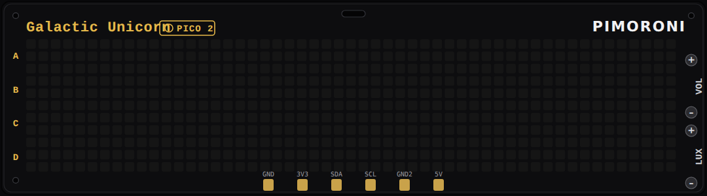
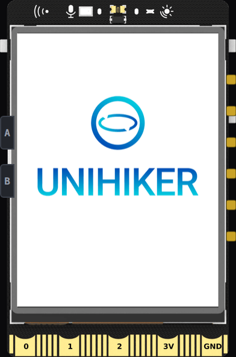

As placas Pro são o nível premium do catálogo: hardware de marca com
periféricos integrados ricos, emulados com profundidade suficiente para
inicializar seu **firmware de fábrica**. Elas fazem parte do catálogo
hospedado em velxio.dev.

:::note[Qual plano elas precisam?]
**Apenas o UNIHIKER M10 exige um plano pago.** Todas as outras placas nesta
página — M5Stack, Pimoroni, XIAO e o ESP32-C6 DevKit — **funcionam no
plano gratuito**. As placas exclusivas para planos pagos são exatamente a
família STM32 e a família Raspberry Pi Linux (à qual o UNIHIKER pertence). Veja
[planos](/docs/pt-br/getting-started/plans/).
:::

## M5Stack

_Plano gratuito._

### M5 Cardputer ADV

O computador de bolso ESP32-S3 com teclado e TFT. Inicializa o firmware
real do launcher M5; digite no teclado na tela, execute apps, use o
alto-falante.

Obtenha a placa real na [loja M5Stack](https://shop.m5stack.com/products/m5stack-cardputer-adv-version-esp32-s3?ref=ehphcrsn&utm_source=velxio&utm_medium=docs-family&utm_content=cardputer-adv).

### M5Stack Core

O clássico ESP32 empilhável com TFT 320x240 e três botões.

Obtenha a placa real na [loja M5Stack](https://shop.m5stack.com/products/esp32-basic-core-lot-development-kit-v2-7?ref=ehphcrsn&utm_source=velxio&utm_medium=docs-family&utm_content=m5stack-core).

*Os links de loja nesta página são links de afiliado: o Velxio recebe uma pequena comissão sem custo extra para você.*

## Pimoroni

_Plano gratuito._

### Badger 2350

O badge de e-paper RP2350. Ele inicializa o **firmware de fábrica do
BadgeOS** completo: navegue pelo launcher com os botões A/B/C/UP/DOWN, abra
os apps de relógio, badge e galeria, e veja o e-paper atualizar da forma
como o e-paper realmente faz.

### Galactic Unicorn

A matriz de LEDs RGB 53x11 (583 pixels) controlada por um Pico 2 W
(RP2350) integrado, com os botões A/B/C/D e os botões de volume /
brilho.

### Pico Plus 2 W

A placa RP2350B da Pimoroni no formato padrão do Pico (GP0..GP28 mais
alimentação), então qualquer ligação do Pico encaixa diretamente nela. GPIO, UART, serial
USB, I2C e SPI funcionam; o coprocessador WiFi CYW43 e a PSRAM não são emulados.

## Seeed Studio XIAO

_Plano gratuito._

### XIAO ESP32S3 Sense

O S3 com o módulo de câmera, microfone PDM e microSD.

### XIAO ESP32C6

C6 RISC-V com capacidade WiFi 6 no formato XIAO.

### XIAO RP2040

O XIAO RP2040 com seu NeoPixel.

### XIAO RP2350

O XIAO RP2350 — dual core a 150 MHz, Arduino C++ ou MicroPython.

### XIAO nRF52840 Sense

O nRF52840 da Nordic com uma IMU de 6 eixos: incline-o pelo botão **Sensors** na
barra de ferramentas da tela. Bluetooth não é emulado.

### Seeeduino XIAO (SAMD21)

O XIAO original, com um DAC real em A0.

### XIAO RA4M1

O MCU do UNO R4 Minima no formato XIAO, com DAC de 12 bits incluído.

### XIAO MG24 Sense

O EFR32MG24 da Silicon Labs com uma IMU de 6 eixos. O rádio não é emulado.

### XIAO nRF54L15 Sense

O nRF54L15 da Nordic com uma IMU de 6 eixos. O rádio não é emulado.

### Placas com Display IPS XIAO

Três placas carrier com um XIAO nRF52840 Plus pré-soldado, desenhadas de frente e
de costas: a [0.96"](/docs/pt-br/boards/reference/xiao-096-display/) (80 x 160, dois
botões), a [1.14"](/docs/pt-br/boards/reference/xiao-114-display/) (135 x 240,
três botões, Grove I2C) e a
[1.47" Touch](/docs/pt-br/boards/reference/xiao-147-touch-display/) (172 x 320,
toque capacitivo, microSD). O vidro é a memória do controlador de painel
emulado; os botões, a IMU, a camada de toque e o cartão funcionam, e os
sketches de demonstração da própria Seeed rodam sem alterações.

## Espressif ESP32-C6

_Plano gratuito._

O **ESP32-C6 DevKit** — o chip RISC-V WiFi-6, com o mesmo trio
de linguagens (Arduino / MicroPython / ESP-IDF) do resto da família ESP32.

## DFRobot UNIHIKER M10

_Plano pago necessário._

Um computador de placa única Linux com tela sensível ao toque integrada — documentado com
a [família Raspberry Pi](/docs/pt-br/boards/raspberry-pi/), já que compartilha o
fluxo de trabalho Linux completo. Como o resto dessa família, é a única placa nesta
página que **exige um plano pago** para funcionar.

Obtenha a placa real na [loja DFRobot](https://www.dfrobot.com/product-2691.html?tracking=rzqVux&utm_source=velxio&utm_medium=docs-family&utm_content=unihiker-m10).

*Este link de loja é um link de afiliado: o Velxio recebe uma pequena comissão sem custo extra para você.*

As placas da DFRobot para o BBC micro:bit, do robô Maqueen Lite ao
micro:Driver, funcionam no plano gratuito e têm uma página própria:
[BBC micro:bit](/docs/pt-br/boards/microbit/).

---

As placas Pro aparecem no [seletor de componentes](/docs/pt-br/circuit-editor/placing-components/)
com um **PRO badge**; os [modelos iniciais](/docs/pt-br/getting-started/projects/)
incluem projetos prontos para executar para cada uma.

## Arte das placas e pinagens

A arte na tela e o mapa completo de pinos de cada placa, gerados a partir do simulador:

[Badger 2350](/docs/pt-br/boards/reference/badger-2350/) ·
[Galactic Unicorn](/docs/pt-br/boards/reference/galactic-unicorn/) ·
[Pico Plus 2 W](/docs/pt-br/boards/reference/pimoroni-pico-plus-2w/) ·
[M5 Cardputer ADV](/docs/pt-br/boards/reference/cardputer-adv/) ·
[M5Stack Core](/docs/pt-br/boards/reference/m5stack-core/) ·
[ESP32-C6 DevKit](/docs/pt-br/boards/reference/esp32-c6/) ·
[XIAO ESP32S3 Sense](/docs/pt-br/boards/reference/xiao-esp32s3-sense/) ·
[XIAO ESP32C6](/docs/pt-br/boards/reference/xiao-esp32c6/) ·
[XIAO RP2040](/docs/pt-br/boards/reference/xiao-rp2040/) ·
[XIAO RP2350](/docs/pt-br/boards/reference/xiao-rp2350/) ·
[XIAO nRF52840 Sense](/docs/pt-br/boards/reference/xiao-nrf52840-sense/) ·
[Seeeduino XIAO (SAMD21)](/docs/pt-br/boards/reference/xiao-samd21/) ·
[XIAO RA4M1](/docs/pt-br/boards/reference/xiao-ra4m1/) ·
[XIAO MG24 Sense](/docs/pt-br/boards/reference/xiao-mg24-sense/) ·
[XIAO nRF54L15 Sense](/docs/pt-br/boards/reference/xiao-nrf54l15-sense/) ·
[XIAO 0.96" IPS Display](/docs/pt-br/boards/reference/xiao-096-display/) ·
[XIAO 1.14" IPS Display](/docs/pt-br/boards/reference/xiao-114-display/) ·
[XIAO 1.47" IPS Touch Display](/docs/pt-br/boards/reference/xiao-147-touch-display/) ·
[UNIHIKER M10](/docs/pt-br/boards/reference/unihiker-m10/)
