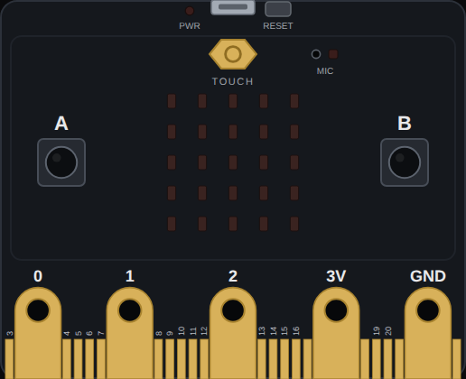

**BBC micro:bit V2** работает в Velxio со своей собственной официальной прошивкой MicroPython (2.1.1), без изменений, на браузерном движке для чипа nRF52833. Пишите на MicroPython, нажмите **Run** (Запуск), и программа выполняется во вкладке браузера, на любом тарифе, включая бесплатный.

## Что работает

- Матрица светодиодов 5x5, кнопки A и B и сенсорный логотип на рисунке, по которому можно кликать.
- Датчик движения (наклоняйте площадку под платой), а также курс по компасу, температура, уровень освещённости и уровень звука, задаваемые на панели датчиков платы.
- Динамик, как только вы включите звук на этой панели, и краевой разъём: подключайте светодиоды, потенциометры, сервоприводы или датчики Grove к его кольцам и полосам, как на настоящей плате.
- REPL в **Serial** (Монитор порта) и **Upload firmware** (Загрузить прошивку) для файла MicroPython `.hex`, сохранённого на python.microbit.org, файлы которого открываются в редакторе.

Пока только **MicroPython**: без Arduino/C++ и без блоков MakeCode (файл MakeCode `.hex` пока не поддерживается). Радиосвязь между двумя micro:bit и Bluetooth не моделируются.

## Начните здесь

- [Hello, World! на матрице светодиодов](https://velxio.dev/example/microbit-v2-hello)
- [Кнопки A и B](https://velxio.dev/example/microbit-v2-buttons)
- [Уровень](https://velxio.dev/example/microbit-v2-spirit-level), на акселерометре
- [Термометр](https://velxio.dev/example/microbit-v2-thermometer), на собственном датчике температуры чипа

## Платы DFRobot для micro:bit

В Velxio есть семь плат DFRobot, каждая из которых является отдельной платой на холсте: разместите её, и micro:bit окажется вставленным в её разъём, при этом матрица и кнопки остаются доступными. Плата с чипами открывается с драйвером MicroPython рядом с `main.py` (`maqueen.py`, `maqueen_v5.py`, `microdriver.py`, `microiobox.py`), который записывает те же байты, что и собственные блоки MakeCode от DFRobot.

### Maqueen Lite

Небольшой двухколёсный робот от DFRobot (ROB0148-EN): два мотора за драйвером на I2C, две фары, два датчика линии, четыре RGB-светодиода и разъём для ультразвукового датчика. В 3D World сам Maqueen является роботом.
[Движение по линии](https://velxio.dev/example/microbit-v2-maqueen-lite-line) ·
[Езда и мигание фарами](https://velxio.dev/example/microbit-v2-maqueen-lite-drive) ·
[Магазин DFRobot](https://www.dfrobot.com/product-1783.html?tracking=rzqVux&utm_source=velxio&utm_medium=docs-family&utm_content=microbit-v2-maqueen-lite)

### Maqueen Lite V5

Текущая Maqueen Lite (MBT0046): RGB-фары, три датчика линии, два датчика освещённости и уровень заряда батареи за собственным контроллером на I2C.
[Цветные фары и датчики освещённости](https://velxio.dev/example/microbit-v2-maqueen-lite-v5-lights) ·
[Магазин DFRobot](https://www.dfrobot.com/product-2937.html?tracking=rzqVux&utm_source=velxio&utm_medium=docs-family&utm_content=microbit-v2-maqueen-lite-v5)

### micro:Driver

Четыре выхода для двигателей постоянного тока и восемь разъёмов для сервоприводов от одного чипа PCA9685 на I2C (DFR0548), плюс девять выводов micro:bit на 3-контактных разъёмах.
[Два сервопривода и двигатель постоянного тока](https://velxio.dev/example/microbit-v2-micro-driver-servos) ·
[Магазин DFRobot](https://www.dfrobot.com/product-1738.html?tracking=rzqVux&utm_source=velxio&utm_medium=docs-family&utm_content=microbit-v2-micro-driver)

### micro:IO-BOX

Компактный контроллер робота (MBT0005): двунаправленный драйвер двигателей на I2C, девять разъёмов ввода-вывода, порты I2C и UART и зуммер на P0.
[Два мотора вперёд и назад](https://velxio.dev/example/microbit-v2-io-box-motors) ·
[Магазин DFRobot](https://www.dfrobot.com/product-1847.html?tracking=rzqVux&utm_source=velxio&utm_medium=docs-family&utm_content=microbit-v2-io-box)

### IO Extender

Плата-разветвитель (MBT0008) со всеми выводами краевого разъёма на 3-контактных разъёмах (сигнал, 3.3 В, земля), тремя портами I2C и зуммером на P0 с переключателем.
[Датчик освещённости на P1](https://velxio.dev/example/microbit-v2-io-extender-light) ·
[Магазин DFRobot](https://www.dfrobot.com/product-1867.html?tracking=rzqVux&utm_source=velxio&utm_medium=docs-family&utm_content=microbit-v2-io-extender)

### micro:Mate

Плата размером с micro:bit (DFR0518), которая прикручивается к её лицевой стороне, с шестью 3-контактными разъёмами Gravity: P0, P1 и P2 на 3.3 В, P8, P12 и P16 на 5 В.
[Датчик освещённости на P0](https://velxio.dev/example/microbit-v2-micro-mate-light) ·
[Магазин DFRobot](https://www.dfrobot.com/product-1699.html?tracking=rzqVux&utm_source=velxio&utm_medium=docs-family&utm_content=microbit-v2-micro-mate)

### Robotics & Power IO Extender

Полноценный разветвитель для micro:bit (DFR1231) с разъёмами IO Extender в том же порядке и с теми же именами выводов, так что проект переносится между ними без переименования проводов.
[Датчик освещённости на P1](https://velxio.dev/example/microbit-v2-robotics-io-extender-light) ·
[Магазин DFRobot](https://www.dfrobot.com/product-2963.html?tracking=rzqVux&utm_source=velxio&utm_medium=docs-family&utm_content=microbit-v2-robotics-io-extender)

_Ссылки на магазин на этой странице являются партнёрскими: Velxio получает небольшую комиссию без дополнительных затрат для вас._

## Изображения плат и распиновки

Изображения плат на холсте и полная карта выводов для каждой платы, сгенерированные из симулятора:

[BBC micro:bit V2](/docs/ru/boards/reference/microbit-v2/) ·
[Maqueen Lite](/docs/ru/boards/reference/microbit-v2-maqueen-lite/) ·
[Maqueen Lite V5](/docs/ru/boards/reference/microbit-v2-maqueen-lite-v5/) ·
[micro:Driver](/docs/ru/boards/reference/microbit-v2-micro-driver/) ·
[micro:IO-BOX](/docs/ru/boards/reference/microbit-v2-io-box/) ·
[IO Extender](/docs/ru/boards/reference/microbit-v2-io-extender/) ·
[micro:Mate](/docs/ru/boards/reference/microbit-v2-micro-mate/) ·
[Robotics & Power IO Extender](/docs/ru/boards/reference/microbit-v2-robotics-io-extender/)

---

BBC micro:bit является товарным знаком Micro:bit Educational Foundation. Velxio работает с micro:bit; он не создан и не одобрен Фондом. Сам micro:bit продаётся через реселлеров, которых Фонд перечисляет на [microbit.org](https://microbit.org/buy/).
