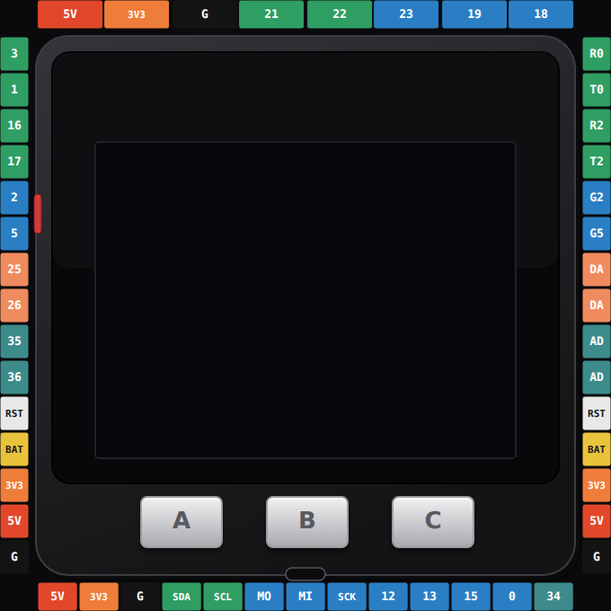

Pro-платы — это премиальный уровень каталога: брендовая аппаратура с богатыми
встроенными периферийными устройствами, эмулируемая достаточно глубоко, чтобы
загружать свою **заводскую прошивку**. Они входят в размещённый каталог на velxio.dev.

:::note[Какой план им нужен?]
**Только UNIHIKER M10 требует платного плана.** Все остальные платы на этой
странице — M5Stack, Pimoroni, XIAO и ESP32-C6 DevKit — **работают на
бесплатном плане**. Платы только для платного плана — это ровно семейство STM32 и
семейство Raspberry Pi Linux (к которому относится UNIHIKER). См.
[планы](/docs/ru/getting-started/plans/).
:::

## M5Stack

_Бесплатный план._

### M5 Cardputer ADV

Карманный компьютер на ESP32-S3 с клавиатурой и TFT. Загружает настоящую
прошивку лаунчера M5; печатайте на экранной клавиатуре, запускайте приложения,
используйте динамик.

Купить настоящую плату в [магазине M5Stack](https://shop.m5stack.com/products/m5stack-cardputer-adv-version-esp32-s3?ref=ehphcrsn&utm_source=velxio&utm_medium=docs-family&utm_content=cardputer-adv).

### M5Stack Core

Классический стековый ESP32 с TFT 320x240 и тремя кнопками.

Купить настоящую плату в [магазине M5Stack](https://shop.m5stack.com/products/esp32-basic-core-lot-development-kit-v2-7?ref=ehphcrsn&utm_source=velxio&utm_medium=docs-family&utm_content=m5stack-core).

*Ссылки на магазины на этой странице являются партнёрскими: Velxio получает небольшую комиссию без дополнительных затрат для вас.*

## Pimoroni

_Бесплатный план._

### Badger 2350

Бейдж на электронных чернилах с RP2350. Загружает полную **заводскую
прошивку BadgeOS**: перемещайтесь по лаунчеру кнопками A/B/C/UP/DOWN, открывайте
приложения часов, бейджа и галереи и наблюдайте, как электронные чернила
обновляются так, как это происходит в реальности.

### Galactic Unicorn

Матрица RGB-светодиодов 53x11 (583 пикселя) под управлением встроенного Pico 2 W
(RP2350), с кнопками A/B/C/D и кнопками громкости / яркости.

### Pico Plus 2 W

Плата Pimoroni на RP2350B в стандартном форм-факторе Pico (GP0..GP28 плюс
питание), поэтому любая схема подключения для Pico подходит к ней напрямую. Работают GPIO, UART, USB-последовательный порт,
I2C и SPI; сопроцессор WiFi CYW43 и PSRAM не эмулируются.

## Seeed Studio XIAO

_Бесплатный план._

### XIAO ESP32S3 Sense

S3 с модулем камеры, PDM-микрофоном и microSD.

### XIAO ESP32C6

RISC-V C6 с поддержкой WiFi 6 в форм-факторе XIAO.

### XIAO RP2040

XIAO на RP2040 со своим NeoPixel.

### XIAO RP2350

XIAO на RP2350 — двухъядерный на 150 МГц, Arduino C++ или MicroPython.

### XIAO nRF52840 Sense

nRF52840 от Nordic с 6-осевым IMU: наклоняйте его кнопкой **Sensors** на
панели инструментов холста. Bluetooth не эмулируется.

### Seeeduino XIAO (SAMD21)

Оригинальный XIAO с настоящим ЦАП на A0.

### XIAO RA4M1

Микроконтроллер UNO R4 Minima в форм-факторе XIAO, включая 12-битный ЦАП.

### XIAO MG24 Sense

EFR32MG24 от Silicon Labs с 6-осевым IMU. Радиомодуль не эмулируется.

### XIAO nRF54L15 Sense

nRF54L15 от Nordic с 6-осевым IMU. Радиомодуль не эмулируется.

### Платы XIAO с IPS-дисплеем

Три платы-носителя с предварительно распаянным XIAO nRF52840 Plus, изображённые спереди и
сзади: [0.96"](/docs/ru/boards/reference/xiao-096-display/) (80 x 160, две
кнопки), [1.14"](/docs/ru/boards/reference/xiao-114-display/) (135 x 240,
три кнопки, Grove I2C) и
[1.47" Touch](/docs/ru/boards/reference/xiao-147-touch-display/) (172 x 320,
ёмкостный сенсор, microSD). Стекло — это память эмулируемого контроллера
панели; кнопки, IMU, сенсорный слой и карта работают, а
демонстрационные скетчи самой Seeed запускаются без изменений.

## Espressif ESP32-C6

_Бесплатный план._

**ESP32-C6 DevKit** — чип RISC-V с WiFi-6, с той же тройкой языков
(Arduino / MicroPython / ESP-IDF), что и остальное семейство ESP32.

## DFRobot UNIHIKER M10

_Требуется платный план._

Одноплатный компьютер на Linux со встроенным сенсорным экраном — описан вместе
с [семейством Raspberry Pi](/docs/ru/boards/raspberry-pi/), поскольку использует
тот же рабочий процесс с полноценным Linux. Как и остальное это семейство, это единственная плата на
этой странице, которой **нужен платный план** для работы.

Купить настоящую плату в [магазине DFRobot](https://www.dfrobot.com/product-2691.html?tracking=rzqVux&utm_source=velxio&utm_medium=docs-family&utm_content=unihiker-m10).

*Эта ссылка на магазин является партнёрской: Velxio получает небольшую комиссию без дополнительных затрат для вас.*

Платы DFRobot для BBC micro:bit, от робота Maqueen Lite до
micro:Driver, работают на бесплатном плане и имеют собственную страницу:
[BBC micro:bit](/docs/ru/boards/microbit/).

---

Pro-платы отображаются в [выборе компонентов](/docs/ru/circuit-editor/placing-components/)
со значком **PRO**; [стартовые шаблоны](/docs/ru/getting-started/projects/)
включают готовые к запуску проекты для каждой из них.

## Изображения плат и распиновки

Изображения каждой платы на холсте и полная карта выводов, сгенерированные симулятором:

[Badger 2350](/docs/ru/boards/reference/badger-2350/) ·
[Galactic Unicorn](/docs/ru/boards/reference/galactic-unicorn/) ·
[Pico Plus 2 W](/docs/ru/boards/reference/pimoroni-pico-plus-2w/) ·
[M5 Cardputer ADV](/docs/ru/boards/reference/cardputer-adv/) ·
[M5Stack Core](/docs/ru/boards/reference/m5stack-core/) ·
[ESP32-C6 DevKit](/docs/ru/boards/reference/esp32-c6/) ·
[XIAO ESP32S3 Sense](/docs/ru/boards/reference/xiao-esp32s3-sense/) ·
[XIAO ESP32C6](/docs/ru/boards/reference/xiao-esp32c6/) ·
[XIAO RP2040](/docs/ru/boards/reference/xiao-rp2040/) ·
[XIAO RP2350](/docs/ru/boards/reference/xiao-rp2350/) ·
[XIAO nRF52840 Sense](/docs/ru/boards/reference/xiao-nrf52840-sense/) ·
[Seeeduino XIAO (SAMD21)](/docs/ru/boards/reference/xiao-samd21/) ·
[XIAO RA4M1](/docs/ru/boards/reference/xiao-ra4m1/) ·
[XIAO MG24 Sense](/docs/ru/boards/reference/xiao-mg24-sense/) ·
[XIAO nRF54L15 Sense](/docs/ru/boards/reference/xiao-nrf54l15-sense/) ·
[XIAO 0.96" IPS Display](/docs/ru/boards/reference/xiao-096-display/) ·
[XIAO 1.14" IPS Display](/docs/ru/boards/reference/xiao-114-display/) ·
[XIAO 1.47" IPS Touch Display](/docs/ru/boards/reference/xiao-147-touch-display/) ·
[UNIHIKER M10](/docs/ru/boards/reference/unihiker-m10/)
