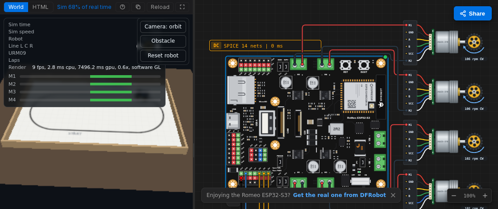
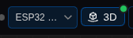
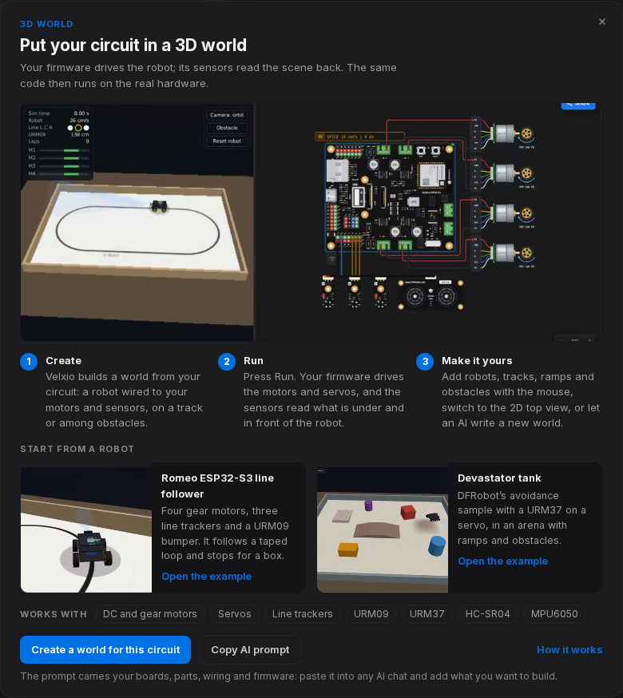
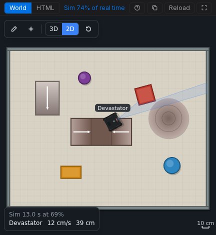

**Мир** (World) помещает вашу схему в физическую сцену. Прошивка выполняется на эмулируемой плате точно так же, как на реальной: двигатели, которыми она управляет, приводят в движение робота, сервоприводы, которые она задаёт, поворачивают манипулятор или датчик, а датчики линии, расстояния и движения считывают то, что находится под роботом и перед ним. Затем тот же код работает на реальном оборудовании.

## Открытие Мира

В каждом проекте с платой есть кнопка **3D** в заголовке холста, рядом с выбором платы:

При первом открытии появляется введение с тремя способами начать:

- **Начать с робота**: откройте готовый проект робота (плата, подключённые двигатели и датчики, прошивка и Мир) и нажмите **Run**. См. [Робот Romeo ESP32-S3, следующий по линии](/docs/ru/worlds/example-romeo-line-follower/) и [Танк Devastator](/docs/ru/worlds/example-devastator-tank/).
- **Создать мир для этой схемы**: Velxio строит начальную сцену из того, что есть на вашем холсте. Двигатели становятся роботом (на двух или четырёх колёсах), под датчиками линии появляется размеченная трасса, перед датчиком расстояния появляются препятствия, а одни только сервоприводы становятся роботом-манипулятором на небольшом столе.
- **Скопировать AI-запрос**: копирует описание с вашими платами, компонентами, подключениями и прошивкой для ChatGPT, Claude или Gemini, чтобы ИИ мог написать любой Мир, который вы опишете. См. [Напишите свой Мир](/docs/ru/worlds/write-your-own/).

Как только в проекте появляется Мир, кнопка 3D переключает между Миром и вашим кодом.

## Нажмите Run

Когда симуляция запускается, в области редактора отображается Мир, а холст остаётся рядом, так что вы можете видеть, как двигатели включаются на схеме, пока робот едет. Цикл замыкается примерно 125 раз в секунду:

1. Прошивка задаёт выводы: направление и скважность PWM для каждого двигателя, импульс для каждого сервопривода.
2. Velxio считывает привод каждого двигателя (через любой драйвер, используемый в схеме) и угол каждого сервопривода и отправляет их в Мир.
3. Мир перемещает робота и измеряет сцену: ленту под каждым датчиком линии, ближайшее препятствие перед каждым датчиком расстояния, ускорение и скорость поворота робота для IMU.
4. Velxio записывает эти показания в компоненты датчиков, и прошивка считывает их при следующем вызове `digitalRead()`, `pulseIn()` или передаче по I2C.

Мир работает на **симулированных часах** платы, а не на реальном времени. Если ваш компьютер выполняет симуляцию вдвое медленнее, робот тоже движется вдвое медленнее, и это по-прежнему согласуется с `millis()` прошивки.

## Панель Мира

| Элемент управления | Что делает                                                                                              |
| ------------------ | ------------------------------------------------------------------------------------------------------- |
| **World / HTML**   | Показать сцену или исходный код `world.html` за ней.                                                     |
| **Guide**          | Краткое пояснение о Мире поверх сцены.                                                                   |
| **Copy AI prompt** | Скопировать описание для внешнего чата с ИИ (см. [Напишите свой Мир](/docs/ru/worlds/write-your-own/)).     |
| **Reload**         | Перезапустить Мир из его файла.                                                                          |
| **Full screen**    | Показать только Мир. Нажмите Esc, чтобы вернуться.                                                       |

Миры, созданные с помощью набора сцен Velxio, добавляют собственную панель инструментов внутри сцены: **Edit**, **Add**, **3D / 2D**, **Camera** (орбита, следование за роботом, вид сверху) и **Reset** (вернуть роботов в начальное положение). См. [Создание сцены](/docs/ru/worlds/scene-editor/).

## 3D или 2D

Для 3D-вида требуется WebGL. Вид **2D** сверху рисует ту же сцену и выполняет ту же физику без видеокарты, поэтому он работает на любом школьном компьютере и является запасным вариантом, когда 3D недоступен.

## С чем работает Мир

- **Считывает**: двигатели постоянного тока и мотор-редукторы (через L293D, транзистор или MOSFET, встроенный драйвер платы или напрямую с вывода) и сервоприводы.
- **Питает**: датчик линии DFRobot Gravity, ультразвуковые датчики URM09 и URM37, HC-SR04 и IMU MPU6050.

Все остальные компоненты (светодиоды, дисплеи, зуммеры) продолжают работать на холсте. Подробности и рецепты прошивки: [Двигатели и датчики](/docs/ru/worlds/motors-and-sensors/).

## Это файл

Мир — это один файл, `world.html`, в группе файлов платы рядом со скетчем. Он сохраняется, передаётся и экспортируется вместе с проектом и никогда не попадает на плату: он не компилируется, не записывается во флеш-память и не копируется на microSD-карту. Удалите файл, и в проекте не будет Мира.
