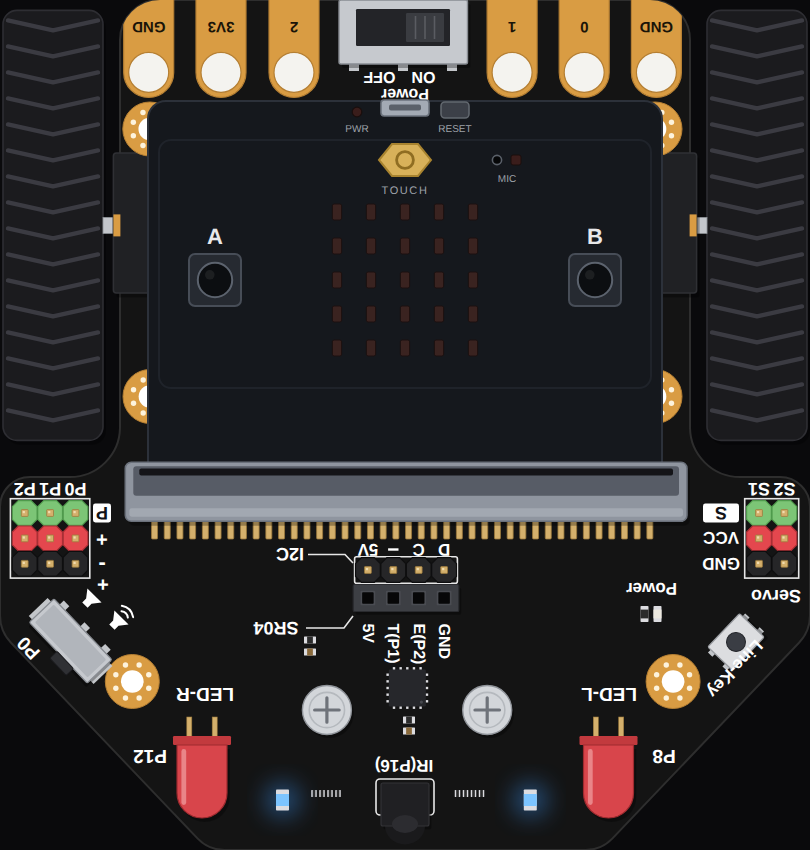

**BBC micro:bit V2** 在 Velxio 中运行其官方 MicroPython 固件（2.1.1），未经修改，运行于针对其 nRF52833 芯片的浏览器内引擎上。编写 MicroPython，按下 Run（运行），程序便会在你的浏览器标签页中运行，适用于所有方案，包括免费方案。

## 可运行的内容

- 5x5 LED 点阵、按键 A 和 B 以及触摸徽标，均绘制在可点击的图形上。
- 运动传感器（倾斜板子下方的垫片）、指南针方向、温度、光照强度和声音强度，均可通过板子的传感器面板设置。
- 扬声器（在该面板中开启声音后可用），以及边缘连接器：像在真实板子上一样，将 LED、电位器、舵机或 Grove 传感器连接到其环形孔和条状孔上。
- Serial Monitor（串口监视器）中的 REPL，以及 **Upload firmware**（上传固件）功能，用于上传由 python.microbit.org 保存的 MicroPython `.hex` 文件，其文件可在编辑器中打开。

目前**仅支持 MicroPython**：不支持 Arduino/C++，也不支持 MakeCode 积木（MakeCode 的 `.hex` 文件尚无法启动）。两个 micro:bit 之间的无线电通信和蓝牙均未建模。

## 从这里开始

- [LED 点阵上的 Hello, World!](https://velxio.dev/example/microbit-v2-hello)
- [按键 A 和 B](https://velxio.dev/example/microbit-v2-buttons)
- [水平仪](https://velxio.dev/example/microbit-v2-spirit-level)，基于加速度计
- [温度计](https://velxio.dev/example/microbit-v2-thermometer)，基于芯片自身的温度

## 适用于 micro:bit 的 DFRobot 扩展板

Velxio 中包含七款 DFRobot 扩展板，每一款在画布上都是独立的板子：放置扩展板后，micro:bit 会安放在其插槽中，点阵和按键仍然可用。带有芯片的扩展板会在 `main.py` 旁边打开一个 MicroPython 驱动（`maqueen.py`、`maqueen_v5.py`、`microdriver.py`、`microiobox.py`），其写入的字节与 DFRobot 自家 MakeCode 积木相同。

### Maqueen Lite

DFRobot 的小型两轮机器人（ROB0148-EN）：I2C 驱动器后的两个电机、两个前灯、两个循线传感器、四个 RGB LED 和一个超声波插座。在 3D World 中，Maqueen 本身就是机器人。
[循线](https://velxio.dev/example/microbit-v2-maqueen-lite-line) ·
[驱动并闪烁前灯](https://velxio.dev/example/microbit-v2-maqueen-lite-drive) ·
[DFRobot 商店](https://www.dfrobot.com/product-1783.html?tracking=rzqVux&utm_source=velxio&utm_medium=docs-family&utm_content=microbit-v2-maqueen-lite)

### Maqueen Lite V5

当前版本的 Maqueen Lite（MBT0046）：RGB 前灯、三个循线传感器、两个光传感器以及 I2C 上独立控制器后的电池电量检测。
[彩色前灯和光传感器](https://velxio.dev/example/microbit-v2-maqueen-lite-v5-lights) ·
[DFRobot 商店](https://www.dfrobot.com/product-2937.html?tracking=rzqVux&utm_source=velxio&utm_medium=docs-family&utm_content=microbit-v2-maqueen-lite-v5)

### micro:Driver

通过 I2C 上的一个 PCA9685 芯片提供四路直流电机输出和八个舵机排针（DFR0548），另有九个 micro:bit 引脚位于 3 针排针上。
[两个舵机和一个直流电机](https://velxio.dev/example/microbit-v2-micro-driver-servos) ·
[DFRobot 商店](https://www.dfrobot.com/product-1738.html?tracking=rzqVux&utm_source=velxio&utm_medium=docs-family&utm_content=microbit-v2-micro-driver)

### micro:IO-BOX

一款紧凑型机器人控制器（MBT0005）：I2C 上的双向电机驱动器、九个 IO 排针、I2C 和 UART 端口以及 P0 上的蜂鸣器。
[两个电机正转和反转](https://velxio.dev/example/microbit-v2-io-box-motors) ·
[DFRobot 商店](https://www.dfrobot.com/product-1847.html?tracking=rzqVux&utm_source=velxio&utm_medium=docs-family&utm_content=microbit-v2-io-box)

### IO Extender

一款引出板（MBT0008），将边缘连接器的每个引脚引出到 3 针排针（信号、3.3 V、接地），另有三个 I2C 端口和 P0 上带开关的蜂鸣器。
[P1 上的光传感器](https://velxio.dev/example/microbit-v2-io-extender-light) ·
[DFRobot 商店](https://www.dfrobot.com/product-1867.html?tracking=rzqVux&utm_source=velxio&utm_medium=docs-family&utm_content=microbit-v2-io-extender)

### micro:Mate

一款与 micro:bit 尺寸相同的板子（DFR0518），可拧在其正面，带有六个 3 针 Gravity 排针：P0、P1 和 P2 为 3.3 V，P8、P12 和 P16 为 5 V。
[P0 上的光传感器](https://velxio.dev/example/microbit-v2-micro-mate-light) ·
[DFRobot 商店](https://www.dfrobot.com/product-1699.html?tracking=rzqVux&utm_source=velxio&utm_medium=docs-family&utm_content=microbit-v2-micro-mate)

### Robotics & Power IO Extender

一款适用于 micro:bit 的完整引出板（DFR1231），其排针顺序和引脚名称与 IO Extender 相同，因此项目可以在两者之间迁移而无需重命名任何接线。
[P1 上的光传感器](https://velxio.dev/example/microbit-v2-robotics-io-extender-light) ·
[DFRobot 商店](https://www.dfrobot.com/product-2963.html?tracking=rzqVux&utm_source=velxio&utm_medium=docs-family&utm_content=microbit-v2-robotics-io-extender)

_本页面的商店链接为推广链接：Velxio 会获得少量佣金，对你没有任何额外费用。_

## 板子图形和引脚图

每款板子的画布图形和完整引脚图，均由模拟器生成：

[BBC micro:bit V2](/docs/zh-cn/boards/reference/microbit-v2/) ·
[Maqueen Lite](/docs/zh-cn/boards/reference/microbit-v2-maqueen-lite/) ·
[Maqueen Lite V5](/docs/zh-cn/boards/reference/microbit-v2-maqueen-lite-v5/) ·
[micro:Driver](/docs/zh-cn/boards/reference/microbit-v2-micro-driver/) ·
[micro:IO-BOX](/docs/zh-cn/boards/reference/microbit-v2-io-box/) ·
[IO Extender](/docs/zh-cn/boards/reference/microbit-v2-io-extender/) ·
[micro:Mate](/docs/zh-cn/boards/reference/microbit-v2-micro-mate/) ·
[Robotics & Power IO Extender](/docs/zh-cn/boards/reference/microbit-v2-robotics-io-extender/)

---

BBC micro:bit 是 Micro:bit Educational Foundation 的商标。Velxio 与 micro:bit 配合使用；并非由该基金会制造或认可。micro:bit 本身通过该基金会在 [microbit.org](https://microbit.org/buy/) 上列出的经销商销售。
