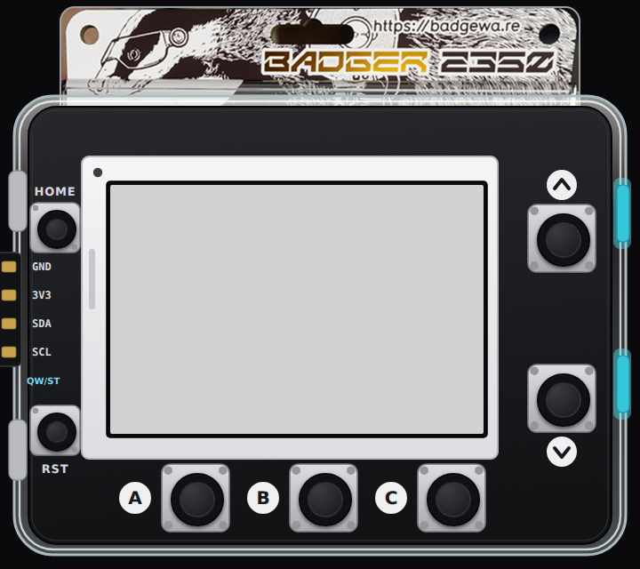
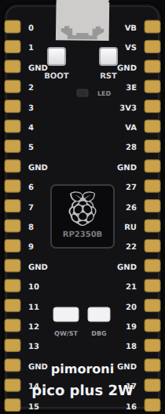
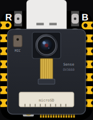
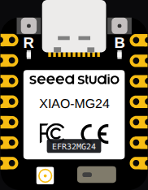
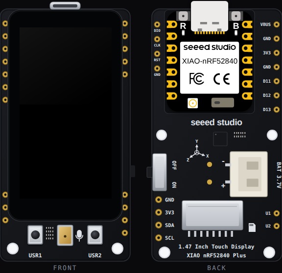

Pro 开发板是目录中的高级层级：品牌硬件，内置丰富外设，仿真深度足以启动其**出厂固件**。它们是 velxio.dev 上托管目录的一部分。

:::note[它们需要哪种套餐？]
**只有 UNIHIKER M10 需要付费套餐。** 本页上的其他所有开发板 — M5Stack、Pimoroni、XIAO 和 ESP32-C6 DevKit — **均可在免费套餐上运行**。仅限付费的开发板恰好是 STM32 系列和 Raspberry Pi Linux 系列（UNIHIKER 就属于后者）。参见[套餐](/docs/zh-cn/getting-started/plans/)。
:::

## M5Stack

_免费套餐。_

### M5 Cardputer ADV

带键盘和 TFT 的 ESP32-S3 口袋电脑。启动真实的 M5 启动器固件；在屏幕键盘上打字、运行应用、使用扬声器。

在 [M5Stack 商店](https://shop.m5stack.com/products/m5stack-cardputer-adv-version-esp32-s3?ref=ehphcrsn&utm_source=velxio&utm_medium=docs-family&utm_content=cardputer-adv)获取真实开发板。

### M5Stack Core

经典的堆叠式 ESP32，配备 320x240 TFT 和三个按键。

在 [M5Stack 商店](https://shop.m5stack.com/products/esp32-basic-core-lot-development-kit-v2-7?ref=ehphcrsn&utm_source=velxio&utm_medium=docs-family&utm_content=m5stack-core)获取真实开发板。

*本页上的商店链接为联盟链接：Velxio 会获得少量佣金，不会给您带来额外费用。*

## Pimoroni

_免费套餐。_

### Badger 2350

RP2350 电子纸徽章。它启动完整的 **BadgeOS 出厂固件**：使用 A/B/C/UP/DOWN 按键浏览启动器，打开时钟、徽章和画廊应用，并观察电子纸以真实电子纸的方式刷新。

### Galactic Unicorn

由板载 Pico 2 W（RP2350）驱动的 53x11 RGB LED 矩阵（583 像素），配有 A/B/C/D 按键以及音量/亮度按键。

### Pico Plus 2 W

Pimoroni 采用标准 Pico 封装（GP0..GP28 加电源）的 RP2350B 开发板，因此任何 Pico 接线都可以直接接上去。GPIO、UART、USB 串口、I2C 和 SPI 均可运行；CYW43 WiFi 协处理器和 PSRAM 未仿真。

## Seeed Studio XIAO

_免费套餐。_

### XIAO ESP32S3 Sense

带摄像头模块、PDM 麦克风和 microSD 的 S3。

### XIAO ESP32C6

采用 XIAO 封装、支持 WiFi 6 的 RISC-V C6。

### XIAO RP2040

带 NeoPixel 的 RP2040 XIAO。

### XIAO RP2350

RP2350 XIAO — 150 MHz 双核，支持 Arduino C++ 或 MicroPython。

### XIAO nRF52840 Sense

Nordic 的 nRF52840，带 6 轴 IMU：通过画布工具栏上的 **Sensors** 按钮倾斜它。蓝牙未仿真。

### Seeeduino XIAO (SAMD21)

初代 XIAO，A0 上带有真正的 DAC。

### XIAO RA4M1

UNO R4 Minima 的 MCU 采用 XIAO 封装，包含 12 位 DAC。

### XIAO MG24 Sense

Silicon Labs 的 EFR32MG24，带 6 轴 IMU。射频未仿真。

### XIAO nRF54L15 Sense

Nordic 的 nRF54L15，带 6 轴 IMU。射频未仿真。

### XIAO IPS 显示屏开发板

三款预焊 XIAO nRF52840 Plus 的载板，正面和背面均有绘制：[0.96"](/docs/zh-cn/boards/reference/xiao-096-display/)（80 x 160，两个按键）、[1.14"](/docs/zh-cn/boards/reference/xiao-114-display/)（135 x 240，三个按键，Grove I2C）和 [1.47" 触摸](/docs/zh-cn/boards/reference/xiao-147-touch-display/)（172 x 320，电容触摸，microSD）。玻璃即仿真面板控制器的内存；按键、IMU、触摸层和存储卡均可工作，Seeed 自带的示例草图可原样运行。

## Espressif ESP32-C6

_免费套餐。_

**ESP32-C6 DevKit** — RISC-V WiFi-6 芯片，与 ESP32 系列其他成员一样支持三种语言（Arduino / MicroPython / ESP-IDF）。

## DFRobot UNIHIKER M10

_需要付费套餐。_

一款内置触摸屏的 Linux 单板计算机 — 由于共享完整的 Linux 工作流程，其文档归入 [Raspberry Pi 系列](/docs/zh-cn/boards/raspberry-pi/)。与该系列其他成员一样，它是本页上唯一**需要付费套餐**才能运行的开发板。

在 [DFRobot 商店](https://www.dfrobot.com/product-2691.html?tracking=rzqVux&utm_source=velxio&utm_medium=docs-family&utm_content=unihiker-m10)获取真实开发板。

*此商店链接为联盟链接：Velxio 会获得少量佣金，不会给您带来额外费用。*

DFRobot 面向 BBC micro:bit 的开发板，从 Maqueen Lite 机器人到 micro:Driver，均可在免费套餐上运行，并有独立页面：[BBC micro:bit](/docs/zh-cn/boards/microbit/)。

---

Pro 开发板在[组件选择器](/docs/zh-cn/circuit-editor/placing-components/)中显示 **PRO 徽章**；[入门模板](/docs/zh-cn/getting-started/projects/)包含每款开发板的即用项目。

## 开发板图稿与引脚图

每款开发板的画布图稿和完整引脚图，均由仿真器生成：

[Badger 2350](/docs/zh-cn/boards/reference/badger-2350/) ·
[Galactic Unicorn](/docs/zh-cn/boards/reference/galactic-unicorn/) ·
[Pico Plus 2 W](/docs/zh-cn/boards/reference/pimoroni-pico-plus-2w/) ·
[M5 Cardputer ADV](/docs/zh-cn/boards/reference/cardputer-adv/) ·
[M5Stack Core](/docs/zh-cn/boards/reference/m5stack-core/) ·
[ESP32-C6 DevKit](/docs/zh-cn/boards/reference/esp32-c6/) ·
[XIAO ESP32S3 Sense](/docs/zh-cn/boards/reference/xiao-esp32s3-sense/) ·
[XIAO ESP32C6](/docs/zh-cn/boards/reference/xiao-esp32c6/) ·
[XIAO RP2040](/docs/zh-cn/boards/reference/xiao-rp2040/) ·
[XIAO RP2350](/docs/zh-cn/boards/reference/xiao-rp2350/) ·
[XIAO nRF52840 Sense](/docs/zh-cn/boards/reference/xiao-nrf52840-sense/) ·
[Seeeduino XIAO (SAMD21)](/docs/zh-cn/boards/reference/xiao-samd21/) ·
[XIAO RA4M1](/docs/zh-cn/boards/reference/xiao-ra4m1/) ·
[XIAO MG24 Sense](/docs/zh-cn/boards/reference/xiao-mg24-sense/) ·
[XIAO nRF54L15 Sense](/docs/zh-cn/boards/reference/xiao-nrf54l15-sense/) ·
[XIAO 0.96" IPS 显示屏](/docs/zh-cn/boards/reference/xiao-096-display/) ·
[XIAO 1.14" IPS 显示屏](/docs/zh-cn/boards/reference/xiao-114-display/) ·
[XIAO 1.47" IPS 触摸显示屏](/docs/zh-cn/boards/reference/xiao-147-touch-display/) ·
[UNIHIKER M10](/docs/zh-cn/boards/reference/unihiker-m10/)
